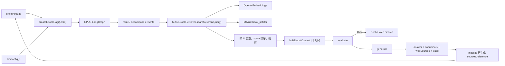
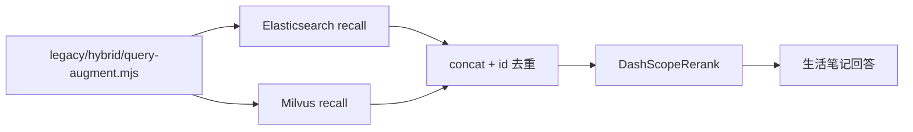
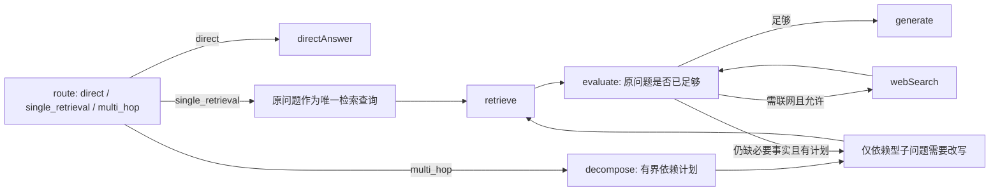

# MemoRAG — SDD 开发规格与分阶段实施计划

> 版本：v1.2（2026-10-14）
>
> 状态：**P3-0～P3-4、P4-A 与 P4-B 已完成；P4-B 的 118/118 Mock 回归及本机 PostgreSQL + Elasticsearch + Milvus 真实 CRUD/混合检索联调均通过，2 条测试笔记已全部清理。P4-A 真实 EPUB 入库、P3-3 LangSmith 云端可见性、P3-2.2 真实模型 coverage 与答案忠实度仍待验收。**
>
> 本版依据当前仓库代码、测试、已安装依赖与旧 Demo 核对。除非明确标注为“已验证”，本文不把历史报告、配置名或旧 Demo 当作现有能力。

## 1. 产品目标与优先级

建立一个以 **Agentic RAG 能力**为核心的智能问答系统，支持两类相互隔离的知识库：

1. **EPUB 电子书**：导入 EPUB、解析/分块/Embedding/向量入库、按 `bookId` 检索、回答与原文引用。
2. **生活笔记**：笔记增删改查、原始笔记存储、同步建立 Elasticsearch 关键词索引与 Milvus 向量索引、问答与来源引用。

共用能力包括：问题路由、多跳问题拆分、依赖型子问题改写、检索轮次限制、证据充分性评估、可选联网补充、引用溯源、Rerank、调用链追踪与测试。

**优先级：RAG 正确性与可验证性 > 数据入库可用性 > API/流式输出 > 简单 React 界面。** 不为堆技术而增加无用复杂度；前端只需演示核心能力。

## 2. P3-0 核对范围与证据边界

本轮只执行了以下只读核对和文档更新：

- 阅读 `backend/src`、`backend/test`、`backend/legacy`、`package.json`、锁文件、`.env.example` 和 README。
- 只读取本地 `.env` 的**变量名**以及非密钥布尔开关状态，不读取或回显任何密钥、URL 值。
- 检查已安装的 `@langchain/*` 与 `langsmith` 源码，以确认当前锁定版本实际接受的环境变量别名。
- 查阅阿里云 Model Studio 官方 Rerank HTTP 协议；未发起 Rerank 请求。
- 未连接 Elasticsearch、Milvus、LangSmith 或 Bocha，未执行数据库读写、付费 API 或真实模型调用。

因此，下列结论必须保持边界：

- `ebook_collection`、1024 维和字符串 `bookId` 是**当前代码默认值/契约**；本轮没有连接 Milvus，不能把它们表述为现存数据库 Schema 的再次验证结果。
- `life_notes` 只是旧 Demo 中的硬编码索引/Collection 名称；仓库没有 Schema、mapping、migration 或探测结果，不能证明任何生活笔记索引实际存在。
- 上轮真实 CLI 结果仅作为历史观察保留；本轮没有复跑真实问答。

## 3. 当前仓库架构与依赖图

### 3.1 当前主线



`createEbookRag()` 通过依赖注入允许 Mock `model`、`retriever` 和 `webSearch`；这也是当前测试不访问真实服务的基础。

### 3.2 旧 Demo（未接入当前主线）



旧混合检索文件具有模块加载即创建客户端、连接既有 Collection、执行图和调用模型的顶层副作用。当前 `package.json` 也未声明它所需的 `@elastic/elasticsearch` 和 `@langchain/community`。因此它不是可直接导入的生产模块。

## 4. 现有能力核对结果

| 能力 | 代码证据 | P3-0 结论 |
| --- | --- | --- |
| `createEbookRag().ask(question, options)` | `src/rag/ebook/index.js` | **已实现**；返回 `answer`、`route`、`sources`、`webSources`、`trace`。 |
| simple/complex 路由与 simple 直答 | `agent-graph.js` 的 `routeQuestion` / `directAnswer` | **已实现并有 Mock 测试**；simple 分支不检索。 |
| 问题拆分 | `decomposeQuestion` | **已实现并有 Mock 覆盖**。 |
| 依赖型子问题改写 | `rewriteSubQuestion`、`validateRewrite` | **已实现并有 Mock 覆盖**；会检查支持文档、实体落地、冲突及模型异常回退。历史真实运行尚未证明进入 `rewritten` 分支。 |
| 改写查询进入实际检索 | `retrieveNode` 使用 `state.currentQuery` | **已实现并有 Mock 覆盖**。 |
| EPUB Milvus 只读检索 | `milvus-retriever.js` | **代码已实现**；Embedding 维度校验、`book_id` 过滤、COSINE、`nprobe` 和字段映射有 Mock 测试。本轮未连真实 Milvus。 |
| 多轮检索、去重、裁剪 | `mergeUniqueDocuments` | **已实现并有 Mock 覆盖**；同 ID 保留较高 Milvus `score`，再排序并限制数量。 |
| 检索/联网次数上限 | `evaluateNode` | **已实现并有 Mock 覆盖**。 |
| Bocha 可选联网 | `config.js`、`web-search.js` | **部分实现**；无 Key 或开关关闭时禁用，次数限制有效；但请求失败会直接抛错，当前没有运行时降级。旧规格中的“Bocha 降级已实现”不成立。 |
| 回答、本地来源、网页来源、执行 trace | `generateNode`、`index.js` | **已实现基础结构**；P3-1 已修复本地引用快照与编号合法性，多轮网页编号仍是已知限制，见第 6 节。 |
| Qwen Rerank | 仅 `legacy/hybrid/dashscope-rerank.mjs` | **未接入主线**。 |
| EPUB 的 ES 混合检索 | 无代码、无索引定义 | **不存在**，本阶段也不设计为 EPUB 能力。 |
| 生活笔记 ES + Milvus 检索 | `src/rag/notes/`、`src/rag/retrieval/` | **P3-4 已产品化并在 P4-B 本机联调中验收**；双源召回、RRF、租户隔离与统一 ID 已跑通，生产环境及真实 Rerank 质量仍未验收。 |
| 生活笔记 CRUD / 原始存储 / 双写 | `src/notes/`、`src/cli/notes.js`、`sql/001_create_life_notes.sql` | **P4-B 已完成 Mock 实现**；PostgreSQL 真相源、稳定 ID、ES/Milvus 同步、墓碑删除与显式重试已覆盖，真实写入未授权验收。 |
| LangSmith | `observability/langsmith.js`、`config.js`、`ebook/index.js` | **P3-3 已完成显式接入**；默认关闭，支持 metadata-only 白名单、full 模式敏感字段屏蔽、测试隔离、Rerank 子 span 和 Client 失败降级。真实云端显示待授权验收。 |
| EPUB 入库 | `src/rag/ebook/ingestion/`、`src/cli/ingest-epub.js` | **P4-A 已完成 Mock 实现**；默认 dry-run，只向已存在且 Schema 兼容的 `ebook_collection` 批量 insert，不创建/删除/加载/重建或覆盖 Collection。真实入库未验收。 |

### 4.1 测试基线

当前有 4 个测试文件，共 16 个 `test()` 声明：

- `agent-graph.test.js`：11 项。
- `config.test.js`：2 项。
- `ebook-rag.test.js`：1 项。
- `milvus-retriever.test.js`：2 项。

在当前 `.env` 下直接执行 `npm test`，测试进程在输出前两个文件后 30 秒内未结束；这是因为当前非密钥开关 `LANGSMITH_TRACING` 处于启用状态，而包含图调用的 Mock 测试会尝试处理外部 trace。显式关闭新旧追踪开关后：

```bash
LANGSMITH_TRACING=false \
LANGSMITH_TRACING_V2=false \
LANGCHAIN_TRACING=false \
LANGCHAIN_TRACING_V2=false \
npm test
```

结果为 4/4 文件级 suite 通过、0 失败，耗时约 0.57 秒。Node 22 的父测试进程按文件汇总为 4 项；源码中实际有 16 个 `test()` 声明。P3 后续所有 Mock 测试都必须显式隔离外部 tracing，不能依赖开发机 `.env`。

## 5. 旧版混合检索与 Rerank 可复用性

| 旧实现 | 可复用内容 | 不可直接复用/必须修正 |
| --- | --- | --- |
| `legacy/hybrid/dashscope-rerank.mjs` | Bearer 鉴权、`model/query/documents/top_n` 请求形状、按返回 `index` 映射原文档的核心思路 | 无超时；不校验空 URL/Key、重复或越界 index；不保留 `relevance_score` 和原始 rank；错误包含完整响应；打印服务返回；只接受顶层 `results`；没有失败回退。应迁移为无副作用的当前模块并补测试，不直接复制类。 |
| `legacy/hybrid/query-augment.mjs` | 结构化三路查询、失败回退、查询去重思路 | 会额外调用 LLM；固定三条；与当前“拆题 + 依赖改写”可能重复放大召回和成本。P3-4 最小实现默认不启用查询扩展，先保证 `currentQuery` 原样透传；后续再以独立开关评测。 |
| `legacy/hybrid/hybrid-retrieval.mjs` | ES hit 转文档、按逻辑 ID 去重、ES/Milvus 并行召回、空集合跳过 Rerank 的思路 | 顶层即连接/执行；依赖缺失；ES 地址、`life_notes`、召回数硬编码；没有 `userId`/知识库过滤；只是 ES 在前、Milvus 在后拼接，既没有 RRF 也没有可靠融合；导入会触发真实服务和模型调用。只能重写为适配层。 |
| `legacy/agentic/agentic-rag.mjs` | 历史节点设计可作对照 | 当前 `src/rag/ebook/agent-graph.js` 已有更完整、安全的改写和可测试结构，不回迁旧实现。 |
| `legacy/agentic/ebook-writter.mjs` | P4-A 已参考其 EPUB 按章、递归字符分块和批量写入流程 | 旧脚本会创建/加载 Collection、硬编码 `ebook2` 并有错误处理缺陷；主线没有直接导入或执行它。 |

### 5.1 Rerank 协议核对

阿里云 Model Studio 当前 `qwen3-rerank` HTTP 兼容协议使用 Bearer Key，正文为顶层 `model`、`query`、`documents`、`top_n`，成功响应在顶层返回按相关性排序的 `results[]`，每项包含输入 `index` 和 `relevance_score`。旧 Demo 的基本请求/响应形状与该协议兼容，前提是 `RERANK_URL` 已指向对应地域和 Workspace 的完整 `/reranks` 端点。

官方参考：<https://docs.modelstudio.console.alibabacloud.com/en/model-studio/text-rerank-api>

本轮为避免暴露配置，未读取当前 `RERANK_URL` 值，也未发送请求；因此不能声称实际端点或鉴权已经联调。若 URL 指向旧的 `gte-rerank` 服务，旧 Demo 的顶层请求形状未必兼容。

## 6. 引用编号问题定位

### 6.1 P3-0 核对时的本地引用数据流（修复前）

1. `retrieveNode` 将新结果交给 `mergeUniqueDocuments`，按 ID 去重、按 `score` 重排并裁剪至 `maxContextDocuments`。
2. 同一节点立即以该 `documents` 数组调用 `buildLocalContext`，按数组下标生成 `[本地1]`～`[本地N]`。
3. `generateNode` 将 `state.localContext` 原样放入模型提示词。
4. 图结束后，`src/rag/ebook/index.js` 对 `result.documents` 再按数组下标生成 `sources[].reference`。
5. `src/cli/chat.js` 对 `result.sources` 使用 `forEach` 全量输出，只把每条正文预览裁剪到 140 字符；它**没有限制来源条数**。

### 6.2 P3-0 定位结论

- 当前代码中，从最后一次 `localContext` 重建到生成和输出之间没有再次改变 `documents` 的路径。因此在同一次当前版本执行里，`localContext` 与 `sources` 的本地数组顺序理论上相同。
- CLI 不会把第 15 条来源截掉；“只显示 14 条”的原因不是 CLI 条数限制。
- `generateNode` 只用自然语言要求模型不要虚构引用，返回后没有解析或校验 `[本地N]`。所以当最终只有 14 条来源时，模型生成 `[本地15]` 会被原样返回。这是当前代码可以确定的首要缺口。
- 因本轮禁止真实付费调用，历史那一次 `[本地15]` 的原始响应未复跑；P3-1 必须先用 14 条 Mock 文档和包含 `[本地15]` 的脚本化答案确定性复现，再修复。
- 本地映射目前是“两处按下标独立重建”，虽暂时同序，Rerank 接入后风险会升高；必须改为同一份最终引用快照驱动 prompt 和 API 输出。

### 6.3 已确认的网页引用问题

`createBochaWebSearch()` 每次调用都从 `[网页1]` 开始生成 `text`，但 `index.js` 对多轮累计的 `webSources` 再从 1 全局编号。第二轮上下文里的 `[网页1]` 最终可能对应 `webSources` 中的 `[网页N]`。本轮 P3-1 按用户确认范围只修复本地引用；多轮网页编号仍是已知未完成项，后续启用多轮网页引用前必须单独修复并验收。

### 6.4 P3-1 最小定位路径

```text
mergeUniqueDocuments
  → 引用快照/编号
  → buildLocalContext
  → generateNode 模型输出
  → 引用解析与合法性校验
  → createEbookRag().sources / webSources
  → CLI 展示
```

“编号存在且可映射”只证明引用格式有效，不证明被引用片段在语义上支持答案。语义蕴含/忠实度评估留在 P5，P3-1 不得宣称自动解决。

## 7. 环境变量与版本兼容核对

### 7.1 当前安装版本

| 包 | 实际安装版本 |
| --- | --- |
| `@langchain/core` | `1.2.17` |
| `@langchain/langgraph` | `1.4.21` |
| `@langchain/openai` | `1.6.2` |
| `langsmith`（传递依赖） | `0.10.11` |
| `@zilliz/milvus2-sdk-node` | `3.0.6` |

### 7.2 LangSmith

对本地已安装源码的核对结论：

- 追踪开关同时识别 `LANGSMITH_TRACING`、`LANGSMITH_TRACING_V2`、旧名 `LANGCHAIN_TRACING` 和 `LANGCHAIN_TRACING_V2`；值只有精确的字符串 `"true"` 才启用。
- API Key、Project 和 Endpoint 通过同一别名读取器解析，优先 `LANGSMITH_*`，再回退 `LANGCHAIN_*`。因此当前 `.env` 中 `LANGSMITH_TRACING` + `LANGCHAIN_API_KEY` + `LANGCHAIN_PROJECT` 的混合命名，在已安装版本上是兼容的。
- SDK 还接受 `LANGSMITH_HIDE_INPUTS`、`LANGSMITH_HIDE_OUTPUTS`、`LANGSMITH_HIDE_METADATA`（以及相应 `LANGCHAIN_*` 别名）。仅隐藏正文但保留安全元数据时，P3-3 应使用显式 Client/Tracer 配置，不能假定设置 env 就完成脱敏。
- P3-0 核对时应用代码没有 LangSmith 配置对象或隐私边界；P3-3 已改为显式配置和作用域，未启用时用 `tracingEnabled:false` 阻断 SDK 对进程环境的隐式继承。
- P3-3 已在 `.env.example` 增加默认关闭的 LangSmith 变量，并通过测试预加载隔离开发机 `.env`。

冻结的兼容策略：

1. 文档和新增配置优先使用 `LANGSMITH_TRACING`、`LANGSMITH_API_KEY`、`LANGSMITH_PROJECT`。
2. 兼容 `LANGCHAIN_API_KEY`、`LANGCHAIN_PROJECT` 以及旧追踪开关；同类变量同时存在时 `LANGSMITH_*` 优先。
3. 默认不开启外部追踪。`metadata_only` 为默认内容策略：保留节点名、耗时、次数、文档 ID、前后 rank 和错误类别，不上传完整 `content`、`localContext`、`webContext` 或生成答案。
4. 生活笔记即使进程级追踪已打开，也必须默认使用 `tracingEnabled: false` 的作用域；只有独立的显式私有数据授权开关开启后才允许 trace，且仍默认 `metadata_only`。
5. Mock 测试必须使用假 Client/Tracer 或显式禁用追踪；不能连接 LangSmith 云端。

### 7.3 Rerank

当前真实 `.env`（仅核对变量名）已有 `RERANK_MODEL`、`RERANK_URL`，没有独立的 `RERANK_API_KEY`；旧 Demo 复用 `OPENAI_API_KEY`。`.env.example` 尚未列出任何 Rerank 变量。

冻结的兼容策略：

| 变量 | 规则 |
| --- | --- |
| `ENABLE_RERANK` | 新增，默认 `false`；关闭时不得构造 Rerank 请求。 |
| `RERANK_URL` | 保留旧名；启用时必填完整 HTTP 端点，不在代码中猜测地域或 Workspace。 |
| `RERANK_MODEL` | 保留旧名；默认 `qwen3-rerank`。 |
| `RERANK_API_KEY` | 新增首选专用 Key。 |
| `DASHSCOPE_API_KEY` | 新增兼容官方常用命名，优先级低于 `RERANK_API_KEY`。 |
| `OPENAI_API_KEY` | 为兼容旧 Demo 的最后回退；文档需提示最好使用专用 Rerank Key。 |
| `RERANK_TOP_N` | 新增；默认沿用最终 `RETRIEVAL_K`。调用级 `askOptions.k` 优先。 |
| `RERANK_CANDIDATE_K` | 新增；必须不小于最终 `topN`，默认至少 20，用于扩大 Milvus 初召回。 |
| `RERANK_TIMEOUT_MS` | 新增，默认 10000 ms。 |
| `RERANK_FAILURE_MODE` | 新增，`fallback`（默认）或 `error`。 |

任何日志、trace 或异常都不得包含 Authorization、Key 或完整服务响应。

## 8. 全局不可破坏约束（Invariants）

- 保持 `createEbookRag().ask(question, options)` 的调用方式，保持 `answer`、`route`、`sources`、`webSources`、`trace` 等现有字段兼容；只允许向后兼容新增字段。
- 不改变 `question` 原始值；动态改写后的实际查询必须进入 Retriever 和启用时的 Rerank，并保留原始子问题及改写记录。
- simple 分支、最大检索次数、最大联网次数、文档 ID 去重与 `bookId` 过滤持续有效。
- Bocha 的“未配置即禁用”行为持续有效；运行时请求失败降级目前未实现，不能误写为已完成，也不在 P3-1～P3-4 中顺手扩 scope。
- **严格知识库隔离**：EPUB 与生活笔记不可误混检；生活笔记必须在 ES 与 Milvus 查询阶段都强制 `userId` 和知识库范围，并对返回结果二次校验。
- 不能跨 Elasticsearch/Milvus 比较原始分数并直接混排；P3-4 使用 rank-based fusion，Rerank 分数和向量分数分别保留。
- **禁止数据库写操作**：P3 只做只读检索和 Mock 测试；不创建、删除、覆盖或重建 Collection/Index，不插入、更新、删除数据。
- 不读取、回显或提交真实密钥。`.env` 不进 Git；新增配置只把变量名和无密钥占位符写入 `.env.example`。
- 默认使用 Mock 测试，不批量触发付费模型、Rerank、联网或 LangSmith API。真实联调必须逐次取得明确授权，并区分 Mock 与真实结果。
- LangSmith 开启时可能上传问题、prompt、上下文、输出和元数据；默认关闭，生活笔记另设默认关闭的作用域保护，不能仅靠“日志不打印原文”声称无外传。

## 9. P3-1～P3-4 可执行任务清单

任务严格按 `P3-1 → P3-2 → P3-2.1 → P3-2.2 → P3-2.3 → P3-3 → P3-4` 执行，一次只做一个任务。每轮完成后先报告并等待用户确认。

### P3-1：引用快照与编号一致性（**代码完成：2026-10-12**）

**完成状态**：本地引用修复代码已完成，20/20 Mock 测试通过；未调用真实模型，真实模型的引用纠正效果待验证。

**实现结果**：

- 生成前在最后一次文档去重、按分数排序和 `maxContextDocuments` 裁剪后冻结有序 `citationDocuments` 快照；`localContext` 与 API `sources` 均由该快照派生，确保 `[本地N]`、文档 ID 和返回数组下标一致。
- 生成后解析所有 `[本地N]`，并以快照长度检查编号是否为规范的 `1..N`。例如只有 14 条来源时，`[本地15]` 会被识别为无效引用；实现不会把越界编号钳制或直接映射成 `[本地14]`。
- 检测到无效引用时，默认最多使用同一份资料快照纠正生成 1 次。纠正提示要求只使用实际存在且资料中提供的引用，并禁止伪造或改变来源 ID；只有纠正输出本身不再含越界编号时才通过编号校验。
- 若纠正调用失败、返回空答案或仍含无效编号，安全回退只移除最终答案中的无效引用标记，保留合法引用和真实来源，不新增来源、不修改来源 ID。
- `trace.citationValidation` 向后兼容地记录状态、来源数量、初始/最终引用、初始无效引用、纠正次数、纠正调用是否失败以及最终移除的无效引用。
- `sources` 可以包含未被答案引用的候选，但答案中的每个有效编号必须能映射到且只能映射到一个来源。
- `answer`、`sources`、`webSources`、`trace` 等原有字段未删除或改名；只在 `trace` 中新增 `citationValidation`。
- `contentSupportChecked` 固定记录为 `false`：当前只验证引用编号存在且可映射，不判断引用片段在语义上是否足以支持对应论述。语义充分性/忠实度仍属于 P5。

**相对 P3-0 冻结设计的变更原因**：

- 冻结稿原计划发现越界引用后直接清理且不重试；本轮实施指令改为优先有限次数纠正，因此实现默认最多纠正 1 次，并在失败后执行确定性清理。
- 冻结稿同时规划了多轮网页全局编号；本轮确认的代码范围只涉及本地 `[本地N]`，因此未修改 `web-search.js`。该问题保留为已知未完成项，不计入本次 20 项 Mock 通过的能力范围。

**修改文件**：

- `backend/src/rag/ebook/agent-graph.js`：引用快照、生成后校验、有限纠正、安全清理与 trace。
- `backend/src/rag/ebook/index.js`：从 `citationDocuments` 快照输出稳定 `sources`，暴露兼容的 `trace.citationValidation`。
- `backend/test/agent-graph.test.js`：覆盖去重、重排、裁剪、合法引用保留、纠正失败清理及普通无引用答案。
- `backend/test/ebook-rag.test.js`：覆盖 14 条来源却生成 `[本地15]`，以及纠正后 `[本地14]` 与 `sources[13]` 的映射。
- `docs/specs/memorag-roadmap.md`：记录 P3-1 状态、实现、测试与限制。

**测试与验收结果**：

- 使用脚本化 Mock 确定性复现“14 条来源但答案含 `[本地15]`”，验证纠正后只保留可映射的 `[本地14]`，同时 trace 保留初始无效编号。
- 覆盖重复 ID 保留高分、重新排序、裁剪后 prompt 编号与引用快照一致；合法 `[本地1]` / `[本地2]` 原样保留。
- 覆盖纠正后仍含非法编号时的清理路径，以及无引用普通答案不触发额外纠正。
- 测试命令显式关闭 `LANGSMITH_TRACING`、`LANGSMITH_TRACING_V2`、`LANGCHAIN_TRACING`、`LANGCHAIN_TRACING_V2`；4 个测试文件共 20 项，20 通过、0 失败。
- 全部测试使用 Mock；未访问真实模型、Milvus、Bocha 或 LangSmith，未执行数据库写入。

**已知限制与尚未完成事项**：

- 真实模型是否能在一次纠正内稳定选择正确且受资料支持的引用尚未验证；不得把 Mock 通过表述为真实纠正效果已验收。
- 当前校验只能证明编号合法并能映射到来源，不能证明引用内容足以支持论述；`contentSupportChecked: false` 明确记录该边界。
- 多轮网页引用的累计编号问题仍未修复；在单独完成该项前，不能宣称网页引用已具备与本地引用相同的一致性保证。
- 最终清理会改变 `answer` 字符串，且删除标记后局部语句可能不够自然；trace 会保留诊断证据，避免静默掩盖模型错误。

**依赖关系**：仅依赖 P3-0 冻结；本地引用快照可作为 P3-2 和 P3-4 的前置基础。本轮结束后不自动开始 P3-2。

### P3-2：EPUB Milvus 候选集接入可选 Qwen Rerank（**代码完成：2026-10-12**）

**目标**：保持 EPUB 只读 Milvus 检索，在功能开关启用时扩大候选集并使用 Qwen Rerank，失败时按配置回退。

**完成状态**：代码及 Graph recursion limit 修复与 39/39 Mock 回归测试已完成；用户已确认修复后的真实环境问答能够结束。真实运行同时暴露过度拆题与检索成本问题，转入 P3-2.1；Qwen Rerank 的系统性排序质量仍待独立评测。

**实现结果**：

- 将旧 Demo 的 Bearer 鉴权及 `model/query/documents/top_n` 请求协议迁移为无顶层副作用的 `DashScopeReranker`，未引入 `@langchain/community`；客户端支持超时，并校验 HTTP 状态、JSON、结果数组、结果数量、相关性分数及缺失/重复/越界 index。
- 新增可选 `RerankingBookRetriever`：启用时使用不小于最终 `topN` 的候选数执行原 Milvus 只读检索，在调用 Rerank 前及映射返回结果后均校验 `bookId`；空的同书候选集不发请求。
- `askOptions.k` 继续表示单轮最终文档数并优先于 `RERANK_TOP_N`；动态改写后的 `currentQuery` 原样传给 Milvus 与 Rerank。关闭 `ENABLE_RERANK` 时不构造请求，保持原检索与 API 行为。
- 保留 Milvus `score` 和全部文档字段，向后兼容新增 `rerankScore`、`originalRank`、`rerankRank`、`rerankStatus`、`rankFusionScore` 元数据；Rerank 分数不会覆盖向量分数。
- 启用 Rerank 后，多轮同 ID 文档按 `1 / (60 + rank)` 累加贡献；并列时按首次出现顺序和文档 ID 稳定排序，不会再次按原始向量分数覆盖重排结果。最终排序仍由 P3-1 的引用快照统一生成 `localContext` 与 `sources`。
- `fallback` 模式在超时、HTTP/网络错误或非法响应时保留原 Milvus 顺序，并仅在 `trace.retrievals[].rerank` 记录安全失败类别、候选/返回数量、文档 ID 和 rank 变化；`error` 模式直接抛出异常。异常和 trace 不包含 Key、Authorization、完整响应或文档正文。
- 配置新增 `ENABLE_RERANK`、`RERANK_URL`、`RERANK_MODEL`、`RERANK_API_KEY`、`DASHSCOPE_API_KEY`、`RERANK_TOP_N`、`RERANK_CANDIDATE_K`、`RERANK_TIMEOUT_MS`、`RERANK_FAILURE_MODE`；Key 优先级为专用 Rerank Key、DashScope Key、旧 Demo 兼容的 OpenAI Key。
- `createEbookRag().ask()` 根据本次调用的本地检索上限和是否可联网，使用图结构的严格上界 `3 * maxRetrievals + 2 * maxWebSearches + 4` 设置 LangGraph `recursionLimit`，覆盖最终 `END` superstep，而不是使用任意放大的固定值。

**冻结设计**：

- 将旧 `DashScopeRerank` 的协议逻辑迁移到无顶层副作用的当前模块；不依赖旧 Hybrid 文件，也不要求引入 `@langchain/community`。
- `askOptions.k` 仍表示最终每轮文档数并优先于 `RERANK_TOP_N`；Milvus 初召回使用不小于最终数量的 `RERANK_CANDIDATE_K`。
- Rerank 输入严格限于同一 `bookId` 的 Milvus 返回结果；调用前与返回后都校验 `bookId`，不得跨书补候选。
- Rerank 查询必须是 `retrieveNode` 实际使用的 `currentQuery`，包括合法的动态改写结果。
- 保留原始 Milvus `score`，新增 `rerankScore`、原始/重排 rank 和状态元数据；不得用 Rerank 分数覆盖向量分数。
- 多轮文档合并不得在 Rerank 后又按原始向量分数把顺序改回去。启用 Rerank 时使用 rank-based 分数 `1 / (60 + rank)` 聚合（`rank` 从 1 开始），同 ID 累加贡献；并列时依次按首次出现顺序、文档 ID 稳定排序。
- 空候选不请求服务；超时、非 2xx、非法 JSON、缺失/重复/越界 index 均按 `RERANK_FAILURE_MODE` 处理。默认 `fallback` 返回原 Milvus 顺序并记录非敏感失败类别。
- `ENABLE_RERANK=false` 时不构造请求，并维持现有无 Rerank 行为。

**修改文件**：

- `backend/src/rag/shared/dashscope-reranker.js`：HTTP 协议、超时、响应校验与安全错误分类。
- `backend/src/rag/ebook/reranking-retriever.js`：候选扩展、同书隔离、结果映射、失败策略与安全 trace。
- `backend/src/config.js`、`backend/.env.example`：Rerank 配置、默认值、兼容优先级与校验。
- `backend/src/rag/ebook/index.js`、`backend/src/rag/ebook/agent-graph.js`：可选装配、实际查询透传、RRF 合并与对外 trace。
- `backend/test/dashscope-reranker.test.js`、`backend/test/reranking-retriever.test.js`：客户端及检索包装层单元测试。
- `backend/test/config.test.js`、`backend/test/agent-graph.test.js`、`backend/test/ebook-rag.test.js`：配置、融合、动态改写、关闭开关、API 与 P3-1 回归测试。
- `backend/README.md`：配置、数据流、失败模式及真实端点未验收说明。
- `docs/specs/memorag-roadmap.md`：P3-2 状态、实现、测试和限制。

**依赖关系**：依赖 P3-1 的稳定引用快照；其共享 Reranker 是 P3-4 的前置。

**验收条件**：

1. Mock HTTP 断言 Bearer 鉴权和 `model/query/documents/top_n` 请求体正确，但测试输出不含 Key。
2. 覆盖排序、`relevance_score` 保存、文档 ID/章节/正文/`bookId` 字段保留、同书过滤和改写查询透传。
3. 覆盖空集合不调用、超时、HTTP 错误、非法响应、重复/越界 index；默认回退顺序正确且 trace 有失败类别。
4. 覆盖多轮 Rerank 后使用冻结的 rank fusion，最终来源顺序与 P3-1 引用快照一致；原始 `score` 未被覆盖。
5. 关闭开关时零 Rerank 调用、现有结果语义和 API 结构不变。
6. 全部测试使用 Mock。只有用户另行提供有效凭证并明确授权后，才允许一次单查询、只读、小候选集的真实联调；未授权时必须标记“协议已 Mock，真实端点未验收”。

**真实环境故障与修复记录（2026-10-12）**：

- 用户真实环境分别以 `ENABLE_RERANK=true` 和 `ENABLE_RERANK=false` 执行同一问题，两者均触发默认 `Recursion limit of 25 reached`，因此故障不能归因于 Rerank。
- 检查确认 `retrieveNode` 每轮都会同时递增 `retrievalCount` 和 `nextSubIdx`，`webSearchNode` 会递增 `webSearchCount`；`evaluateNode` 在对应上限耗尽后强制进入 `generate`。条件边没有无界回路。
- 根因是合法复杂路径超过 LangGraph 默认 25 步：8 次本地检索需要执行 27 个节点，并需要第 28 个终止 superstep；若再执行 2 次联网，需执行 31 个节点并需要第 32 个终止 superstep。
- Mock 在默认 25 步下精确复现了节点序列于第 8 次 `retrieve` 后报错；按公式设置 28/32 后，纯本地最大路径及“8 次本地检索 + 2 次联网”最大路径均正常进入 `generate` 并结束。
- 与 P3-1 提交对比，循环边、索引和计数推进逻辑并非 P3-2 引入；Rerank 只可能通过证据排序影响评估器是否提早结束，不改变循环的理论上限。

**测试与验收结果**：

- 6 个测试文件共 39 项，39 通过、0 失败；运行时显式设置 `LANGSMITH_TRACING=false`、`LANGSMITH_TRACING_V2=false`、`LANGCHAIN_TRACING=false`、`LANGCHAIN_TRACING_V2=false`。
- Mock HTTP 已验证 Bearer 请求头和旧 Demo 的请求体形状；覆盖空候选、超时、非 2xx、非法 JSON、缺失/重复/越界 index，以及错误信息不泄露测试 Key 或响应正文。
- 检索测试覆盖候选扩大、`askOptions.k` 优先、同书过滤、字段与原始 `score` 保留、默认回退及 `error` 模式；Graph/API 回归覆盖动态改写查询透传、RRF、多轮 trace、开关关闭时零 Rerank 调用和原有 `answer/sources/webSources/trace` 接口。
- Graph 终止回归记录并断言最大合法节点序列、每轮子问题索引/检索次数、每轮联网次数；同时覆盖 Rerank 关闭、正常返回和异常回退时，证据持续不足且评估器重复要求检索仍能在第 8 次后生成并终止。
- P3-1 的引用编号纠正、simple/complex 路由、检索轮次、可选联网与纯 Milvus 检索测试全部继续通过。全程未访问真实模型、Qwen Rerank、Milvus、Bocha 或 LangSmith，也未执行数据库写入。

**已知限制与尚未完成事项**：

- 真实 Qwen Rerank 端点的协议兼容性、模型可用性、延迟、费用、限流和排序质量尚未验收；当前只能表述为 Mock 协议与本地排序逻辑通过。
- 用户已确认修复后的真实环境问答能够结束；本次复验同时观察到单一问题被拆成 8 个子问题、执行 8 次本地检索并累计 23 条来源，属于 P3-2.1 的已确认效率与决策质量问题。
- 默认关闭 Rerank；启用会把候选正文发送到配置的外部端点。部署方需自行确认数据授权、地域与服务条款，并优先使用专用 `RERANK_API_KEY`。
- `fallback` 保障服务故障时可继续回答，但不能提供 Rerank 质量提升；跨查询只融合 rank，不比较不同查询间不可直接比较的原始 Rerank 分数。
- P3-3 的显式 LangSmith 隔离和 P3-4 的 ES + Milvus 混合检索均未开始，其任务状态保持不变。

**主要风险**：不同查询的原始 Rerank 分数不可直接比较，因此跨子问题只融合 rank，不融合原始分数；候选集过大会增加费用和延迟，默认关闭。

### P3-2.1：Agent 决策与检索效率优化（**代码完成：2026-10-13**）

**任务性质**：P3-2 的独立小任务；只优化 EPUB Agent 的决策、检索次数、上下文和本地指标，不开始 P3-3/P3-4，不改变数据库，不新增外部服务。

**完成状态**：代码、配置、README 与 Mock 回归已完成，SDD 升级为 v0.5；6 个测试文件共 50 项，50 通过、0 失败。用户随后完成两条真实问题验收，单跳/多跳路由、检索次数与 LLM 调用预算均符合预期，但暴露答案忠实度、依赖改写失败恢复和证据覆盖判断缺口，转入 P3-2.2。

**真实问题基线**：对“阿朱为什么要假扮段正淳？”的真实问答能够正常结束，但被路由为 `complex`，生成 8 个子问题、执行 8 次本地检索并累计 23 条引用文档；部分子问题与原问题无关或包含未经证实的事实前提，造成延迟和 Token 消耗显著放大。

**代码根因分析**：

1. 当前 `RouteSchema` 只有 `simple|complex`：`simple` 同时表示“不查库”，`complex` 同时表示“要查库且必须拆题”。它没有区分“需要书中证据的单跳问题”和“必须依赖多个事实的多跳问题”。
2. `complex` 唯一路径固定进入 `decomposeQuestionNode`。拆题提示虽然要求最少拆分，却以“输出 1～8 条”提供了较高上限；同时要求每条写全人物/事件名，即使相关实体尚未由证据确认，也会诱导模型提前补全实体或事件。
3. 拆题结果目前只做 trim 和非空检查，没有去重、依赖顺序、必要性或新增前提校验；模型返回 8 条时会全部成为可执行计划。
4. `evaluateNode` 已具备提前选择 `generate` 的能力，所以不是代码强制“必须完成全部子问题”；但 prompt 展示全部未检索项并强调剩余数量，容易让模型把完成计划当作目标，而不是只判断原始问题是否已经可回答。
5. `rewriteSubQuestionNode` 已校验解析实体必须出现在前序证据中，这能阻止无依据实体替换；但它会对第一轮之后的每个子问题调用模型，且只校验实体落地，不校验“为什么/是否/谁”等疑问意图是否被保留，无法阻止把疑问改写成事实断言。
6. 每轮评估都携带完整累计 `localContext`；默认 `MAX_CONTEXT_DOCUMENTS=24`。8 轮路径在不发生引用纠正和联网时，最坏需要 1 次路由、1 次拆题、最多 7 次改写、8 次评估和 1 次生成，即最多 18 次 LLM 调用，另有 8 次 Embedding、启用时 8 次 Rerank。
7. P3-2 Rerank 不生成子问题，也不改变循环上限；它只会通过文档排序间接影响评估器是否认为证据充分。开关关闭时同样存在过度拆题，因此不能通过调整 Rerank 掩盖决策问题。

**最小数据流调整**：



**冻结设计**：

1. **三态路由且保持接口兼容**
   - 将内部路由改为 `direct|single_retrieval|multi_hop`，仍只使用当前一次路由 LLM 调用，不增加分类调用。
   - `direct` 仅用于寒暄、普通常识及不需要书中证据的问题；书中人物、情节、动机、地点或原文问题不得进入直接回答。
   - `single_retrieval` 用于一个完整检索查询即可回答的问题，包括单一人物事实、单一事件和单一动机/因果问题。“阿朱为什么要假扮段正淳？”应进入该路径。
   - `multi_hop` 仅用于答案确实依赖两个及以上事实、关系链、跨人物比较或明确先后推理的问题。
   - 对外 `route.strategy` 继续兼容：`direct` 映射为 `simple`，两个检索模式映射为 `complex`；向后兼容新增 `route.mode` 和 trace 中的路由依据。

2. **单跳 RAG 不拆题**
   - 路由为 `single_retrieval` 时，直接把原始问题设置为唯一 `subQuestion/currentQuery`，跳过 `decomposeQuestionNode` 和 `rewriteSubQuestionNode`，优先只执行一次本地检索。
   - 检索后仍经过一次 `evaluateNode`。首轮证据不足时，按后续实施指令允许一次受控补充检索：系统保留原始疑问，并把 `missing` 作为“补充检索重点”确定性附加，不再调用拆题或改写模型；默认 `MAX_SINGLE_RETRIEVALS=2`、允许 1～3，且仍受全局 `MAX_RETRIEVALS` 约束。也可在已授权且未超预算时选择联网。
   - 首轮充分、无联网、无引用纠正时，目标成本为 3 次 LLM 调用（route、evaluate、generate）、1 次 Embedding，以及启用时最多 1 次 Rerank；执行一次本地补检时为 4 次 LLM 调用、2 次 Embedding，以及启用时最多 2 次 Rerank。

3. **多跳拆题改为有界依赖计划**
   - 新增 `MAX_SUB_QUESTIONS`，默认 4、允许 1～8；8 仅作为显式配置的复杂场景上限，不再作为普通问题的默认生成倾向。
   - 拆题结果改为结构化计划项：`question`、`purpose`、`dependsOn`、`introducedAssumptions`。`purpose` 必须说明该项填补原问题的哪一项必要信息；`dependsOn` 只能引用更早的计划项。
   - prompt 明确“通常 2 条，只有不可合并的必要事实才增加”；禁止人物背景、章节盘点、旁支验证和用户未问内容。未知实体必须保留为“前一步确认的人物/事件”等依赖表达，不得猜测并写成具体名称。
   - 代码执行规范化去重、数量限制、依赖下标/环检查；任何未来依赖、重复项、超过上限或显式报告了 `introducedAssumptions` 的计划均不执行。按后续实施指令，使用同一个拆题 schema 最多修复 1 次（`MAX_PLAN_REPAIR_ATTEMPTS` 允许 0～2），不增加独立验证模型；仍失败时 fail closed，回退到原始问题的受控单跳路径，不执行部分可疑计划。
   - 该结构校验不能数学证明语义相关性；真实相关性仍需固定问题集评测，文档不得把 Mock 结构校验表述为“消除所有模型幻觉”。

4. **充分即停，不把计划当清单**
   - `EvaluateSchema` 新增 `isSufficient`；只要已有资料能够回答原始问题，代码强制 `nextAction=generate`，即使仍有未执行计划。
   - 只有 `isSufficient=false`、`missing` 非空、下一计划项直接覆盖必要缺口且仍有预算时才允许继续本地检索。
   - prompt 将“原始问题可回答性”放在首位，明确未完成子问题本身不构成证据不足；计划项只是候选检索手段，不是必须完成的 checklist。
   - 保留现有本地检索、联网和 recursion limit 硬上限；模型重复要求检索时仍由代码强制终止。

5. **依赖改写保持疑问意图**
   - 仅 `dependsOn` 非空的计划项调用改写模型；独立子问题直接使用原查询，避免无收益的改写调用。
   - 改写证据只取声明依赖项的检索结果，不再把全部历史证据都暴露给改写器。
   - 继续使用现有“实体必须同时出现在支持文档和改写查询中”的校验，并增加疑问意图守卫：原问题含“谁/为什么/为何/如何/是否/哪里/多少”等标记时，改写结果必须保留对应疑问类型；否则回退原查询并记录原因。
   - 改写只能补全已证实实体，不得新增事件、因果或结论；`reason` 仍不作为事实证据。

6. **上下文和 Token 预算**
   - 保留 P3-1 引用快照和 P3-2 RRF/Rerank 逻辑；将 `MAX_CONTEXT_DOCUMENTS` 默认值从 24 调整为 12，仍允许部署方显式配置。
   - 评估器不再接收完整最终上下文，而只接收当前排序前 6 条、每条最多 600 字符的紧凑证据视图；生成节点仍使用最终引用快照，避免影响引用编号一致性。
   - 改写器只接收声明依赖的最多 4 条证据、每条最多 500 字符。单跳路径默认最多累积两轮结果，且只有首轮不足时才允许第二轮。
   - 本任务不下调 Milvus/Rerank 单轮 `k`，避免在没有质量评测时同时改变召回宽度；先通过路径和累计上下文上限控制成本。

7. **本地量化指标，不提前实现 P3-3**
   - 在现有 `trace` 中向后兼容新增 `execution`：`totalDurationMs`、逐节点 `durationMs`/执行次数、实际 `llmCallCount`、按 route/decompose/rewrite/evaluate/generate/citation-correction 分类的调用次数、本地检索次数、Rerank 请求/回退次数、联网次数、最终上下文文档数。
   - 指标随单次请求状态累计，不能使用 graph 闭包中的共享可变计数器，以免并发请求互相污染。
   - trace 只记录计数、耗时、节点名、状态和文档 ID，不记录 prompt、完整正文、Key 或完整模型响应；不创建 LangSmith Client，不发送网络请求。P3-3 后续只能复用这些安全 metadata，不能反向扩大本任务范围。

8. **保留真正的多跳能力**
   - `multi_hop` 仍保留有序拆题、证据依赖改写、多轮检索、RRF、Rerank、提前充分性评估和联网分支。
   - 默认 4 条是成本预算而非能力硬删除；确有复杂语料时可显式把 `MAX_SUB_QUESTIONS` 配置到 8，现有 `MAX_RETRIEVALS` 继续作为独立硬上限。
   - 依赖型测试必须证明第二步查询只使用第一步已检索证据解析实体；优化单跳路径不得用“所有问题只检索一次”的方式实现。

**实现结果**：

- 内部路由已升级为 `direct|single_retrieval|multi_hop`；对外继续返回兼容的 `route.strategy: simple|complex`，并新增 `route.mode`。
- 固定问题“阿朱为什么要假扮段正淳？”的 Mock 路径从优化前 27 个业务节点、8 次本地检索、18 次 LLM 调用，降为 5 个业务节点、1 次本地检索、3 次 LLM 调用；若把最终 `END` superstep 计入，则为 28 步降至 6 步。
- 单跳首轮不足时默认只允许 1 次补检，补充查询由“原问题 + 缺失信息”确定性生成，不调用拆题或改写模型；联网继续受现有开关和次数上限控制。
- 多跳计划使用结构化依赖项并执行数量、重复、未来依赖和新增前提校验；默认最多修复 1 次，仍失败时记录 `fallback_single` 并安全执行原问题。
- `isSufficient=true` 会由代码强制进入生成；多跳继续检索还要求 `missing` 非空、下一计划项覆盖缺口且仍有预算。
- 独立计划项不调用改写模型；依赖项只读取声明依赖的最多 4 条证据，并增加疑问意图守卫。
- 默认最终上下文上限改为 12；评估上下文限制为前 6 条、每条 600 字符，改写证据限制为每条 500 字符。
- 新增请求内 `trace.execution`，记录逐节点次数/耗时、LLM 分类调用数、本地检索、Rerank 请求/回退、联网和最终上下文数量；不记录 prompt、正文、Key 或完整模型响应。

**修改文件**：

- `backend/src/rag/ebook/agent-graph.js`：三态路由、单跳边、有界计划、依赖驱动改写、充分即停、紧凑评估上下文和请求内指标。
- `backend/src/rag/ebook/index.js`：装配新上限，保持旧 route 字段并新增 `route.mode`、`trace.execution`。
- `backend/src/cli/chat.js`：展示内部路由模式以及节点、检索、LLM 和总耗时统计，便于真实验收对比。
- `backend/src/config.js`、`backend/.env.example`：新增 `MAX_SUB_QUESTIONS=4`、`MAX_PLAN_REPAIR_ATTEMPTS=1`、`MAX_SINGLE_RETRIEVALS=2`，把 `MAX_CONTEXT_DOCUMENTS` 默认/示例调整为 12，并校验各预算边界。
- `backend/test/agent-graph.test.js`：节点路径、计划校验、提前终止、改写意图、上下文边界和指标单元测试。
- `backend/test/ebook-rag.test.js`：单跳/多跳 API 兼容、Rerank 开关与回退、调用次数和来源上限回归。
- `backend/README.md`：路由模式、成本预算、配置和安全 trace 说明。
- `docs/specs/memorag-roadmap.md`：实施后记录完成状态、实际测试数和已知限制。

**Mock 测试覆盖**：

1. 寒暄进入 `direct`，零检索；书中单一事实/动机进入 `single_retrieval`，不调用拆题和改写。
2. 以“阿朱为什么要假扮段正淳？”为固定回归输入，脚本化路由为单跳后只检索 1 次；原问题原样进入 Milvus/Rerank，来源不超过单轮 `k` 和总上下文上限。
3. 真正依赖型问题仍进入 `multi_hop`，两步计划中的第二步只使用第一步证据完成实体改写，最终回答保留两轮来源。
4. 拆题返回 8 条、重复项、未来依赖或非空 `introducedAssumptions` 时，计划不直接执行；覆盖一次修复成功、一次修复仍失败后回退，以及合法配置到 8 仍受检索硬上限约束。
5. 第一轮资料已经充分但仍有计划项时，评估器返回 `isSufficient=true` 后立即生成；Mock 断言未调用后续 Retriever/Reranker。
6. 评估器持续报告不足时，现有检索/联网上限及 recursion limit 仍保证终止；覆盖 Rerank 关闭、成功和异常回退。
7. 独立的后续子问题不调用改写模型；依赖改写覆盖合法实体、无证据实体、冲突实体及丢失“为什么/谁/是否”等疑问意图的回退。
8. 注入超过 12 条文档和超长正文，断言最终引用快照不超过 12，评估 prompt 只含前 6 条及截断内容，引用编号继续合法。
9. 对 direct、single、multi、引用纠正和 Rerank fallback 路径断言 `trace.execution` 的 LLM/检索/Rerank 次数准确、耗时非负，且不包含正文和测试 Key。
10. 完整运行现有 Mock 回归，显式关闭四个 LangSmith/LangChain tracing 开关；不得访问真实模型、Rerank、Bocha、Milvus 或数据库。

**验收标准**：

1. 固定单跳回归问题只执行 1 次本地检索、0 次拆题、0 次改写；无联网和引用纠正时实际 LLM 调用数为 3，最终来源不超过该次最终 `k`（默认 8）且不超过总上下文上限。
2. 默认多跳计划不超过 4 条；非法计划最多修复 1 次且不会部分执行，修复失败时 trace 明确记录 `fallback_single` 及安全失败原因。
3. 第一轮证据充分时，即使计划仍有剩余项也必须进入生成；不得为了清空计划继续检索。
4. 默认最终本地上下文不超过 12 条；评估上下文不超过 6 条、每条不超过 600 字符；P3-1 引用编号与 P3-2 排序契约全部保持。
5. 真正依赖型两跳/三跳问题继续完成证据约束改写和多轮检索；不得把优化实现为全局单次检索。
6. `answer/route/sources/webSources/trace` 原字段不删除、不改名；`route.strategy` 仍只返回兼容的 `simple|complex`，新增字段均为向后兼容。
7. trace 能给出逐节点耗时、实际 LLM 调用数、本地检索数、Rerank 请求/回退数、联网数和最终上下文数，且不泄露正文、prompt 或凭证。
8. 所有 Mock 回归通过；真实质量验收至少比较固定问题集的 route mode、子问题数、检索数、来源数、总耗时和回答正确性，未获授权前不得主动执行。

**测试与验收结果**：

- 6 个测试文件共 50 项，50 通过、0 失败；显式关闭 `LANGSMITH_TRACING`、`LANGSMITH_TRACING_V2`、`LANGCHAIN_TRACING`、`LANGCHAIN_TRACING_V2`。
- 覆盖 direct 零检索、固定问题单跳、一次受控补检、受控联网、计划结构拒绝/修复/安全回退、第一轮充分即停、依赖改写与疑问意图回退、12/6/600 上下文边界及安全执行指标。
- 继续覆盖真正依赖型两跳/三跳、最大 8 轮合法路径、Rerank 关闭/成功/失败回退、引用纠正和既有 API 字段。
- 测试均使用脚本化 Mock；未访问真实模型、Qwen Rerank、Milvus、Bocha、LangSmith 或数据库。
- 用户真实验收中，单跳样例执行 1 次检索、3 次 LLM 调用、约 21 秒；多跳样例执行 2 次检索、6 次 LLM 调用、约 87 秒，证明效率预算生效，但两次回答分别出现错误人物关系和依赖问题未完整回答。本项不能据此宣称真实答案质量已验收。

**已知限制与决策边界**：

- Mock 只能验证路径和预算，不能证明真实模型一定正确区分单跳/多跳，也不能完全检测模型未主动报告的语义无关项或隐藏错误前提；需要后续小规模固定真实问题集复验。
- 本任务记录本地指标但不做 LangSmith tracing、token usage provider 账单对账或跨请求聚合；这些仍属于 P3-3/质量评测范围。
- 将默认最终上下文降至 12 可能牺牲部分长链问题召回；必须通过真正多跳用例回归，并允许显式配置回 24，但不得因此取消单跳路径和提前终止。

**依赖关系**：依赖 P3-1 引用快照、P3-2 Rerank/trace 和 recursion limit 修复；代码已完成，等待用户验收。本轮不自动开始 P3-3。

### P3-2.2：证据覆盖与依赖检索恢复（**代码完成：2026-10-13**）

**任务性质**：P3-2.1 真实验收后的独立修复任务。只修复证据覆盖判断、依赖改写引用、占位查询回退、回答忠实度和本地耗时诊断；不放宽实体证据约束，不通过增加全局检索上限掩盖缺口，不接入 P3-3/P3-4。

**完成状态**：实现、配置、README 与 Mock 回归已完成，SDD 升级为 v0.6；6 个测试文件共 59 项，59 通过、0 失败。测试时显式关闭 LangSmith/LangChain 新旧追踪开关，未调用真实模型、Qwen Rerank、Bocha、LangSmith 或数据库。真实模型能否稳定给出正确 coverage，以及固定真实问题上的答案忠实度，仍待用户验收。

**真实验收观察（用户提供）**：

1. “阿朱为什么要假扮段正淳？”进入 `single_retrieval`，执行 1 次本地检索、3 次 LLM 调用、耗时约 21 秒；效率预算符合预期，但最终回答错误声称段正淳是萧峰的亲生父亲，并混淆雁门关带头大哥。
2. “误杀阿朱的人是谁？他后来经历了什么？”进入 `multi_hop`，执行 2 次本地检索、6 次 LLM 调用、耗时约 87 秒；第二项为“第 1 项确认的人物在误杀阿朱之后经历了什么？”，改写因支持文档 ID 不属于前序检索而被拒绝，回退查询未检索到人物后续经历，最终答案不完整。

#### 实施前代码已证实的问题（均由本任务针对性处理）

1. **当前 trace 不能证明第一轮证据是否足够**：`trace.retrievals[0]` 只暴露查询和文档 ID，不暴露被改写器实际使用的前 4 条证据摘录；最终 `sources` 又可能经过跨轮去重、RRF 和裁剪。没有本次真实 `documentIds + sources` 内容，无法确认第一轮是否明确写出了人物身份。
2. **无效支持文档 ID 被拒绝是正确的安全行为**：改写模型自由生成 `supportingDocumentIds`；代码把它们转为字符串后要求与声明依赖项的证据 ID 精确匹配，并继续检查实体同时出现在所选证据和改写查询中。任何不属于前序证据的 ID 都必须拒绝，不能模糊匹配、钳制或改用模型记忆。
3. **改写失败后的查询回退存在确定性缺陷**：`fallback_invalid_rewrite`、模型异常和依赖无证据三条路径都会把 `currentQuery` 设置为原始计划项。若计划项包含“第 1 项确认的人物”等依赖占位表达，该占位文本会未经解析直接传入 Retriever。
4. **计划项执行与证据覆盖被错误地等同**：`retrieveNode` 无论查询是否因改写失败而退化、结果是否相关，都会递增 `nextSubIdx`。第二项检索结束后，两项计划即被视为执行完毕。
5. **计划耗尽后无法做本地缺口恢复**：`evaluateNode` 的多跳本地继续条件要求 `remaining > 0`。两项都执行后，即使模型返回 `isSufficient=false` 和非空 `missing`，本地 `retrieve` 也会被代码改为 `generate`；只有模型主动选择且配置允许时才可能联网。
6. **充分性只有一个全局布尔值**：当前没有逐问题部分/逐计划项的覆盖状态，也不要求 `isSufficient=true` 为“人物身份”和“后续经历”等每个必要部分提供有效支持文档。因此评估器可能把部分覆盖误判成完整覆盖。
7. **当前检索结果不能证明知识库不存在资料**：Milvus 适配器只执行过滤后的 top-k 向量检索，没有校准后的相关性阈值、覆盖清单或全库事实索引。零结果只能说明当前查询无命中；有结果但不支持问题只能说明本轮召回不充分，二者都不能推出“知识库不存在相关资料”。
8. **生成阶段缺少语义忠实度门控**：生成器会接收最多 12 条累计文档；P3-1 只校验 `[本地N]` 编号存在，`contentSupportChecked` 明确为 `false`。因此模型可以引用合法编号却组合出资料未支持的人物关系或事件前提。
9. **现有耗时指标可按节点归因，但本次数据不足**：`trace.execution.nodes` 已分别累计 route、decompose、rewrite、retrieve、evaluate、generate 的次数与耗时；CLI 目前只打印总节点数、LLM 次数和总耗时。用户本次只提供约 87 秒总耗时，没有提供各节点 `durationMs`，所以不能证实哪个节点最慢。
10. **检索节点内部仍不可拆分**：`retrieve.durationMs` 同时包含 Embedding、Milvus 和可选 Rerank；`generate.durationMs` 也包含可能的引用纠正。即使取得现有节点明细，也无法进一步区分这些内部阶段。

#### 尚需真实证据验证的推测

- 单跳错误答案可能来自召回文档本身包含相邻但无关的人物关系，也可能是生成模型在正确资料上发生关系混合；未检查该次 `sources` 正文前不能归因于 Retriever 或 Generator。
- 改写返回非法文档 ID 可能是模型复制长 ID 时格式变化，也可能是纯粹幻觉；当前失败 trace 不保留模型尝试的引用和允许列表，无法区分。
- 87 秒路径的 6 次 LLM 调用按代码通常对应 route 1、decompose 1、rewrite 1、evaluate 2、generate 1；LLM 很可能占主要时间，但在取得 `trace.execution.nodes` 前只能视为推测。若启用了 Rerank，retrieve 节点也可能占显著比例。
- 第一轮是否已经足以确认“误杀阿朱的人是谁”以及知识库是否包含“后来经历”的片段，均需对照该次检索 ID、来源正文和 Rerank 状态，当前报告不能下结论。

#### 最小修复设计

1. **用证据序号代替模型自由复制文档 ID**
   - 改写 prompt 为声明依赖证据生成请求内连续的 `evidenceIndex`；模型返回 `supportingEvidenceIndexes`，代码只接受范围内整数，再确定性映射到真实文档 ID。评估器使用独立的请求内证据序号，不能把 `[本地N]` 当作内部证据 ID。
   - 映射后继续执行现有强校验：每个解析实体必须同时出现在被选证据正文和改写查询中；冲突、越界、空证据或疑问意图丢失仍严格拒绝。
   - 不对任意字符串 ID 做模糊匹配，不把非法编号映射为最近/最大合法项，不使用改写模型的 `reason` 作为证据。
   - 失败 trace 只新增安全诊断：失败码、模型尝试的证据序号、允许序号、最终映射的真实 ID；不记录完整模型响应或正文。

2. **禁止占位表达进入 Retriever**
   - 对依赖计划项识别“第 N 项确认的人物/事件”“前一项人物”等占位表达；只有通过严格证据校验的改写结果可以替换它们。
   - 改写失败时不得直接检索含占位符的计划文本。安全回退使用用户原始完整问题作为一次自包含查询，并记录 `dependency_fallback_original_question`；该查询不补入任何未经证实的实体，也不增加 LLM 调用。
   - 若原始问题与已执行查询规范化后完全重复，则不重复调用 Retriever，直接把该答案部分标记为未解决并交给充分性评估。

3. **按必要答案部分记录证据覆盖**
   - `EvaluateSchema` 向后兼容新增 `coverage[]`，每项对应计划索引，状态为 `supported|missing|conflicting`，并通过请求内证据序号列出支持项。
   - 评估证据快照继续限制为最多 6 条，但按计划项平衡抽取并去重，至少优先保留每个已执行计划项的最高排名证据，避免后一轮结果把第一轮身份依据全部挤出评估上下文。
   - 代码只在所有必要计划项均为 `supported`、每项至少有一个范围内证据、且不存在 `missing/conflicting` 时接受 `isSufficient=true`；否则覆盖结果优先于模型的全局布尔值。
   - 单跳问题视为一个必要答案部分；多跳问题按计划项分别判断。计划“执行过”不再等价于“已被证据支持”。
   - 进入依赖项改写前，代码必须确认其全部 `dependsOn` 已为 `supported`；依赖仍为 `missing/conflicting` 时不调用改写模型，不让占位查询进入 Retriever，而是优先使用定向恢复预算或生成明确的部分答案。

4. **使用现有预算做一次定向缺口恢复**
   - 新增独立的 `MAX_GAP_RECOVERY_ATTEMPTS`，默认 1、允许 0～1；它是现有 `MAX_RETRIEVALS` 内部的用途预算，不提高全局检索上限。
   - 当计划已耗尽但仍有必要答案部分为 `missing`，且尚未恢复时，使用“原始问题 + 缺失部分说明”的确定性自包含查询补检一次，不调用拆题/改写模型，也不包含未解析占位符。
   - 恢复后仍不足时，若联网已授权则允许一次受现有上限控制的 web fallback；否则生成明确的部分回答和“本次检索未找到足够证据”，不得声称知识库不存在资料。
   - 冲突证据不得通过重复检索自动选边；应保留 `conflicting` 并在回答中说明无法确认。

5. **只把覆盖验证过的证据交给生成器**
   - 由 `coverage` 中已验证的证据 ID 冻结 `answerEvidenceDocuments`，再按该快照生成本地上下文、引用编号和 API `sources`，继续遵守 P3-1 的同一快照约束。
   - 未被任何必要答案部分选中的干扰文档不进入生成 prompt，降低模型混合人物关系和事件的机会；证据不足的部分只传递结构化缺口，不把不相关 top-k 当作事实材料。
   - 生成 prompt 明确：只陈述选中证据直接支持的关系；用户问题含错误前提或资料冲突时必须指出，不能为了完整作答补造关系。
   - 最小实现不新增常驻的语义审查 LLM 调用。编号合法性继续由 P3-1 校验；真实语义蕴含仍不能仅靠结构校验完全保证，若固定真实集仍失败，再在 P5 评估是否增加有限的 claim-evidence verifier。

6. **区分召回结果与知识库存在性**
   - 本地状态记录 `not_retrieved`、`no_hits_for_query`、`retrieved_not_supportive`、`relevant_but_insufficient`、`supported`、`conflicting` 和 `retrieval_error`。其中独立布尔字段分别保留“是否执行过检索、是否存在相关证据、是否足以支持答案”，禁止从未命中或不支持推导 `knowledge_base_absent`。
   - 回答用语限定为“本次检索未找到/现有资料不足以确认”。只有未来存在经过验证的全库覆盖清单或专门存在性查询时，才允许声称知识库不含该资料；本任务不新增数据库 Schema 或写操作。

7. **补足本地耗时诊断，不接入 LangSmith**
   - CLI 展示 `trace.execution.nodes` 的逐节点次数和耗时，而不是只打印总耗时。
   - 为纯 Milvus 路径记录 `embeddingDurationMs`、`vectorSearchDurationMs`；为 Rerank 路径另记 `rerankDurationMs`，同时保留总 `retrieve.durationMs`。生成节点分离初次生成与引用纠正耗时。
   - 所有指标仍为请求内本地 metadata，不记录 prompt、正文、答案或凭证，不发送外部 trace；这不改变 P3-3 的状态。

#### 实际实现结果

- 依赖改写现在只接受 `[证据N]` 形式的请求内连续序号，代码在范围校验通过后确定性映射为真实文档 ID；失败 trace 保留失败码、尝试/允许序号和已映射 ID。越界序号不会被钳制或替换为其他合法证据，实体落地、冲突和疑问意图校验继续 fail closed。
- 依赖未充分、改写拒绝或模型异常时，Graph 使用用户原始完整问题作为安全查询；若与已执行查询规范化后重复，则跳过 Retriever 并继续评估。内部依赖占位符不会直接进入 Retriever，`trace.rewriteHistory` 和 `trace.retrievals` 记录回退原因及实际查询。
- coverage 按必要计划项分别记录 `retrieved`、`hasRelevantEvidence`、`isSufficient`、冲突、支持证据序号/真实 ID、缺口和安全状态。合法证据序号本身不构成相关或充分；代码只在所有必要项均充分且无冲突时接受整体充分。联网证据只能在已有联网上下文且模型显式标记时支持 coverage，不伪造本地证据编号。
- 评估快照按检索轮次轮询、去重并限制为 6 条，避免后轮结果完全挤出前轮依据。计划项已经执行但没有足够证据时继续保持未解决；计划耗尽后最多调度一次“原始问题 + 缺口说明”的确定性恢复查询，计入原 `MAX_RETRIEVALS` 和单跳预算，不增加全局上限。
- 生成器仅使用 coverage 判定充分的本地证据冻结 `answerEvidenceDocuments`、`localContext` 和 API `sources`。未解决部分以结构化缺口进入 prompt，并被要求明确说明无法确认；不相关候选不会因为文档序号合法而进入最终引用快照。P3-1 的编号校验继续执行，`contentSupportChecked` 仍为 `false`。
- Milvus 检索记录 Embedding/向量查询耗时，Rerank 包装记录 Rerank 与总耗时，生成区分初次回答和引用纠正耗时；CLI 展示逐节点、检索分段和生成分段指标。所有对外新增信息均位于兼容 trace 字段或文档元数据中，不删除 `answer/sources/webSources/trace` 既有字段，不记录正文、prompt 或凭证。
- Retriever 异常在 Graph 内转换为安全的 `retrieval_error` 与未解决 coverage，仍进入有界评估/部分回答路径；底层 Rerank `failureMode=error` 的适配器契约不变。

**实际修改文件**：

- `backend/src/rag/ebook/agent-graph.js`：证据序号映射、占位符安全回退、逐项 coverage、一次定向缺口恢复和生成证据快照。
- `backend/src/rag/ebook/index.js`：保持 API 兼容，暴露安全 coverage/rewrite/retrieval 诊断与细分耗时。
- `backend/src/rag/ebook/milvus-retriever.js`、`reranking-retriever.js`：只读检索阶段耗时拆分，不改变查询或数据库。
- `backend/src/config.js`、`backend/.env.example`：新增 `MAX_GAP_RECOVERY_ATTEMPTS=1`，范围 0～1，不调整 `MAX_RETRIEVALS` 默认值。
- `backend/src/cli/chat.js`：打印逐节点和检索内部耗时。
- `backend/test/agent-graph.test.js`、`ebook-rag.test.js`、`milvus-retriever.test.js`、`reranking-retriever.test.js`、`config.test.js`：新增确定性回归。
- `backend/README.md`、`docs/specs/memorag-roadmap.md`：记录证据边界、恢复预算、指标和真实验收结果。

**Mock 回归设计**：

1. 第一轮返回相关人物但没有明确身份关系时，coverage 必须为 `missing`，不得仅因有 top-k 文档就标记充分。
2. 第一轮包含明确身份证据，改写返回合法证据序号时，代码映射为真实 ID 并完成依赖查询；返回越界序号、冲突实体或无依据实体时继续严格拒绝。
3. 改写 ID/序号非法、模型异常、依赖无证据三种情况下，Retriever 收到的查询均不含“第 1 项确认的人物”等占位表达，也不含模型未证实的具体实体。
4. 两项计划都执行但第二部分仍缺证据时，只允许一次定向恢复；恢复查询保留原始疑问，检索总数仍受原 `MAX_RETRIEVALS` 约束，不通过提高上限实现。
5. 定向恢复成功后 coverage 全部支持并生成完整答案；恢复仍失败且未启用联网时生成部分回答，明确“本次检索不足”，不声称“知识库不存在”。
6. 覆盖零命中、返回文档但不支持、冲突证据、Retriever 异常，分别得到不同安全状态。
7. 注入一个明确支持文档和多个含错误人物关系的高分干扰文档，断言生成 prompt 与最终引用快照只包含 coverage 选中的证据；合法但未选中的干扰文档不进入生成上下文。
8. 生成答案仍覆盖 P3-1 的合法/非法编号处理；断言 `contentSupportChecked` 不被错误改成 `true`，避免把结构化覆盖夸大为完整语义蕴含验证。
9. `trace.execution` 与 CLI 覆盖 route、decompose、rewrite、embedding、Milvus、Rerank、evaluate、generate、citation-correction 的非负耗时与次数，且不包含正文、prompt 或测试 Key。
10. 完整运行现有 Mock 回归，保持 single 3-call 快路径、真正多跳能力、Rerank 回退与 Graph 终止上限。

**验收标准**：

1. 任何含依赖占位符且未通过证据约束改写的字符串都不得进入 Retriever；不得通过放宽实体或文档证据校验提高改写成功率。
2. 支持证据引用由有限序号确定性映射到真实文档 ID；越界或未映射序号 fail closed，且不会被修正为其他合法证据。
3. `isSufficient=true` 必须同时满足所有必要答案部分的结构化 coverage；计划执行完但 coverage 缺失时不得静默生成“完整答案”。
4. 定向缺口恢复最多 1 次、计入现有全局检索预算；不修改 `MAX_RETRIEVALS` 默认值，不为两条验收问题硬编码人物或答案。
5. `no_hits_for_query` 与 `retrieved_not_supportive` 可区分；两者均不得被表述为“知识库不存在资料”。
6. 生成器只接收 coverage 选中的引用快照，`answer/sources/webSources/trace` 旧字段保持兼容，P3-1 编号校验和 P3-2 Rerank 顺序约束继续通过。
7. 给出真实 87 秒 trace 时，可由本地指标分别报告路由、拆题、改写、Embedding、Milvus、Rerank、评估、生成和引用纠正耗时；没有明细时不得猜测主要瓶颈。
8. 全部 Mock 通过；未获授权前不调用真实付费 API，不连接或修改数据库，不开始 P3-3。

**实际测试结果**：显式关闭 LangSmith 新旧追踪开关后执行完整 `npm test`，6/6 文件级 suite 通过；源码中共 59 个 `test()`，59 通过、0 失败。新增回归覆盖三层 coverage、合法序号但内容不相关、相关但不充分、越界改写证据序号、占位符安全回退、一次缺口恢复及成功后的干扰文档剔除、Retriever 异常、跨轮平衡证据、未直接执行但已被证据覆盖的依赖复用、coverage 证据白名单、14 条来源时 `[本地15]` 仍判非法、Rerank 开启/关闭/回退终止，以及 Embedding/Milvus/Rerank/生成细分耗时。单跳首轮充分路径仍为 1 次检索、3 次 LLM 调用；真正两跳且两轮充分路径仍为 2 次检索、6 次 LLM 调用。只有证据不足且启用缺口恢复时，才增加 1 次检索和 1 次评估 LLM，不新增改写 LLM，且不突破既有预算。

**已知限制**：结构化 coverage 与证据 allowlist 能阻止明显无证据路径并减少干扰上下文，但仍不能数学证明模型输出的每个自然语言论断都被证据蕴含。coverage 模型本身仍可能发生语义误判；真实答案忠实度必须用固定问题集复验，完整 claim-evidence 评估仍属于 P5。`no_hits_for_query` 只表示本次查询无命中，`retrieved_not_supportive` 只表示当前召回不能支持答案，均不能证明知识库不存在资料。多轮网页引用编号问题仍未在本任务修复。

**依赖关系**：依赖 P3-1 引用快照和 P3-2.1 路由/指标；代码已完成，等待真实环境验收。本轮不开始 P3-3。

### P3-2.3：LangGraph 模块化重构与解耦（**代码完成：2026-10-13**）

**任务性质**：以 Git commit `cdd7fb8` 为稳定行为基线，只拆分 `backend/src/rag/ebook/agent-graph.js` 的结构职责，不修改三态路由、拆题、依赖改写、检索、Rerank、coverage、缺口恢复、联网、生成、引用校验、异常回退或循环预算。

**完成状态**：模块化重构与 59/59 Mock 行为回归已完成，SDD 升级为 v0.7。`agent-graph.js` 从 1676 行减少为 131 行，仅保留配置边界归一化、依赖装配、节点注册、条件边和编译；拆分后相关代码共 1816 行，目标是降低耦合而非压缩总代码量。未调用真实模型、Qwen Rerank、Bocha、LangSmith 或数据库。

**实际模块结构与职责**：

- `state.js`：唯一维护 LangGraph State Annotation 与初始状态，不创建外部客户端。
- `schemas.js`：集中保存 route、decompose、rewrite、coverage/evaluate 的 Zod 输出契约。
- `nodes/route.js`：三态路由和单跳检索准备；`nodes/decompose.js`：受限拆题、有限计划修复和安全单跳回退。
- `nodes/rewrite.js`：依赖证据约束改写、占位符阻断和原始完整问题回退；`nodes/retrieve.js`：实际查询调用、Rerank trace、文档合并及检索历史。
- `nodes/evaluate.js`：逐项 coverage、预算判断、缺口恢复和联网决策；`nodes/web-search.js`：受图预算控制的联网结果合并；`nodes/generate.js`：direct/证据受限生成和引用纠正调用。
- `services/evidence.js`：改写/评估证据快照、coverage 归一化及改写结果纯校验；`services/citations.js`：消息正文转换、引用编号校验/清理和有限纠正生成。
- `services/document-merge.js`：普通分数合并、RRF、上下文构造；`services/planning.js`：计划校验、查询规范化、补检查询和 recursion limit；`services/execution.js`：请求内节点、LLM、检索、Rerank、联网次数与耗时累计。

**依赖传递和兼容边界**：

- `createAgenticRagGraph()` 仍是唯一装配入口。`model`、`retriever`、`webSearch`、书名及预算先按原规则归一化，再通过节点工厂参数显式注入；模块 import 阶段不执行模型调用、检索、联网或数据库访问。
- Graph 的 State 字段、9 个节点名称、全部条件边、终止路径及 `recursionLimit` 公式保持不变。节点只依赖 schema 和无状态 service，service 不反向导入节点或 Graph，检查未发现循环依赖。
- `agent-graph.js` 继续重导出原有 11 个公共符号，`createEbookRag().ask()` 以及 `answer/route/sources/webSources/trace` 字段不变；配置默认值、prompt 文义、检索参数、RRF、排序和 coverage 规则均未调整。

**实际修改文件**：

- `backend/src/rag/ebook/agent-graph.js`：收缩为 Graph 装配和兼容导出层。
- 新增 `backend/src/rag/ebook/state.js`、`schemas.js`。
- 新增 `backend/src/rag/ebook/nodes/{route,decompose,rewrite,retrieve,evaluate,web-search,generate}.js`。
- 新增 `backend/src/rag/ebook/services/{evidence,citations,document-merge,execution,planning}.js`。
- `backend/test/agent-graph.test.js`：在既有依赖型两跳用例中增加确定性行为契约，不增加测试数量。
- `docs/specs/memorag-roadmap.md`：记录 P3-2.3 完成状态、模块边界、测试和限制。

**测试与行为对照结果**：

- 先在 `cdd7fb8` 单文件结构上锁定既有两跳场景的确定性契约，再用同一测试验证重构结果：节点类型及执行次数、实际检索查询和 2 次检索、分类后的 6 次 LLM 调用、依赖改写、coverage、引用文档快照和引用校验完全一致；耗时只校验非确定性的字段结构与数值类型。
- 显式关闭 `LANGSMITH_TRACING`、`LANGSMITH_TRACING_V2`、`LANGCHAIN_TRACING`、`LANGCHAIN_TRACING_V2` 后执行完整 `npm test`，6/6 文件级 suite 通过；源码共 59 个 `test()`，59 通过、0 失败。
- 回归继续覆盖三态路由、计划修复、安全改写回退、coverage 与一次缺口恢复、文档去重/RRF/Rerank、引用编号与来源快照、异常/预算/最大合法循环终止以及 API/trace 兼容。
- 所有新增模块通过 Node 语法检查；静态 import 关系为单向依赖，未发现循环或 import-time 外部副作用。

**行为差异与已知限制**：没有发现确定性业务行为差异。模块拆分本身不改善 P3-2.2 已知的真实模型语义误判、答案忠实度或多轮网页编号问题，也未验证真实服务集成；这些限制继续按原阶段归属处理。重构保留少量模块内重复的 `unique` 辅助函数，以避免为了消除几行重复代码引入跨 service 耦合。

**依赖关系**：依赖 `cdd7fb8` 的 P3-2.2 稳定基线；P3-3 可在本结构上按节点边界接入显式追踪，但本任务没有开始 P3-3 或 P3-4。

### P3-3：LangSmith 显式追踪与隐私边界

**完成状态**：代码、配置模板、README 和 68/68 Mock 回归已完成，SDD 升级为 v0.8。追踪默认关闭；配置缺失、作用域关闭或 LangSmith Client 失败均不影响正常问答。本轮只使用内存假 Client，未调用 LangSmith 云端、真实模型、Rerank、Bocha 或数据库。

**目标**：在默认不外传的前提下，可选观察 `route/decompose/rewrite/retrieve/rerank/evaluate/web/generate`，并消除开发机 env 对 Mock 测试的隐式影响。

**冻结设计**：

- 应用显式解析追踪配置和别名，采用第 7.2 节的优先级；未启用时不创建 Client/Tracer，不产生外部请求。
- 若代码直接 import `langsmith`，将它从传递依赖提升为 `package.json` 的直接依赖并锁定兼容版本。
- 内容策略新增应用级 `MEMORAG_LANGSMITH_CONTENT_MODE=metadata_only|full`，默认 `metadata_only`。
- `metadata_only` 使用显式 Client 的 inputs/outputs 隐藏能力，并只通过安全 metadata 记录：节点名、耗时、检索/联网次数、实际查询、文档 ID、Rerank 前后 rank、回退/错误类别。不得上传完整文档正文、拼接上下文、网页摘要、模型完整回答或凭证。
- `full` 只在用户明确知情时用于非私人场景；README 必须说明会上传 prompt、问题、上下文和输出。
- 为未来生活笔记预留独立 `ENABLE_NOTE_LANGSMITH_TRACING=false`。即使全局 `LANGSMITH_TRACING=true`，笔记作用域也用当前 SDK 支持的 `tracingEnabled: false` 阻断继承；只有显式开启才可发送，且默认仍为 `metadata_only`。
- 追踪失败不得影响问答结果；但错误只能记录类型和 request/run id，不记录敏感 payload。

**预计修改范围**：

- `backend/src/config.js`、`.env.example`：追踪、内容模式和笔记独立开关。
- 新增 `backend/src/observability/langsmith.js`：别名归一化、Client/Tracer 构建、关闭作用域和 metadata 白名单/脱敏。
- `backend/src/rag/ebook/index.js`、`agent-graph.js` 及 P3-2 Rerank 包装层：节点名和安全 metadata。
- `backend/package.json`、`package-lock.json`：如直接 import，则声明 `langsmith` 直接依赖。
- 新增 observability/config 测试，更新 graph 回归和 `backend/README.md`。

**依赖关系**：功能上依赖 P3-2，才能一次覆盖 Rerank span；P3-4 必须复用其生活笔记关闭作用域和脱敏策略。

**验收条件**：

1. 不设置开关或设置为 false 时，Mock Client 零调用；现有问答输出完全一致，完整 `npm test` 不等待外部网络。
2. 单元测试证明 `LANGSMITH_*` 优先、`LANGCHAIN_API_KEY` / `LANGCHAIN_PROJECT` / 旧 tracing 名可回退，且测试后恢复 `process.env`，不污染其他 case。
3. 使用内存假 Client 验证全部目标节点可见；metadata 包含 query、文档 ID、rank、次数和错误类别。
4. 在 `metadata_only` payload 中断言不存在测试用敏感哨兵字符串、`content`、`localContext`、`webContext`、完整回答和任何 Key。
5. 全局 tracing=true、笔记开关=false 时，模拟笔记作用域不产生 trace；显式开启后才产生脱敏 trace。
6. 追踪 Client 抛错时问答仍成功，并有不含 payload 的本地诊断。
7. 默认验收不访问 LangSmith 云端。只有明确授权后才做一次最小真实 trace，并把“本地配置通过”和“云端 trace 可见”分别报告。

**主要风险**：LangGraph/LLM 自动 tracing 默认会捕获完整节点输入输出；仅添加 metadata 而不隐藏默认 inputs/outputs 仍会泄露正文，验收必须检查最终 payload。

**实际实现结果**：

- `createEbookRag().ask()` 使用 LangSmith 官方 `traceable` 建立请求级根 span，LangGraph 通过现有 callback/AsyncLocalStorage 机制自动生成 Graph 和节点子 span；未重写节点执行逻辑。可观察 `routeQuestion`、`decomposeQuestion`、`rewriteSubQuestion`、`retrieve`、`evaluate`、`webSearch`、`generate`，Rerank 通过同一上下文中的 `rerank` 子 span 补齐。
- 显式配置识别 `LANGSMITH_TRACING`、`LANGSMITH_TRACING_V2`、`LANGCHAIN_TRACING`、`LANGCHAIN_TRACING_V2`，只有优先级最高的已设置变量精确等于字符串 `true` 才请求启用；Key、Project、Endpoint 优先 `LANGSMITH_*`，再回退 `LANGCHAIN_*`。请求启用但没有 Key 时安全关闭并记录 `missing_api_key`，不抛错。
- 默认 `MEMORAG_LANGSMITH_CONTENT_MODE=metadata_only`。发送前清空每个 run 的 inputs、outputs、events、attachments 和 serialized payload，只保留 span 名称/类型、耗时、实际检索 query、文档 ID、计划/检索/联网/LLM 次数、coverage 安全状态、Rerank 前后 rank 和错误类别等白名单 metadata。
- `full` 模式允许上传问题、prompt、上下文和输出，但发送前仍递归屏蔽名称包含 API Key、Token、Authorization、Secret、Password、Credential 或 Cookie 的字段，并把完整错误信息收敛为类别。README 明确标注该模式只能用于用户知情且无私人内容的环境。
- `ENABLE_NOTE_LANGSMITH_TRACING=false` 默认阻断未来生活笔记作用域；即使全局环境开启追踪，notes scope 仍使用 `tracingEnabled:false`。只有独立显式开启时才可追踪，且默认内容模式仍为 `metadata_only`。
- 未启用时不创建 LangSmith Client，并用官方 `tracingEnabled:false` 作用域压制 SDK 从开发机环境隐式继承的 tracer。`npm test` 预加载隔离文件，将新旧四个 tracing 开关强制设为 false，因此不再依赖调用者手工设置 shell 变量，也不会因 `.env` 中的开关等待外部 trace。
- LangSmith Client 的 `createRun`、`updateRun` 和 flush 异常在适配层内转换为不含 message/payload 的安全错误类别；问答结果不受影响。`trace.langsmith` 向后兼容新增 requested/enabled/contentMode/project/traceId/disabledReason/errorCount/errors，CLI 仅在启用时打印 project、trace ID 和内容模式。
- 直接使用 `langsmith` SDK，因此将当前锁定的 `0.10.11` 提升为直接依赖；没有增加额外监控服务、评测平台或数据库状态。

**实际修改文件**：

- 新增 `backend/src/observability/langsmith.js`：显式作用域、Client 构建、metadata-only 白名单、full 模式密钥字段屏蔽、错误隔离和 Rerank 子 span。
- `backend/src/config.js`、`backend/.env.example`：追踪别名、内容模式、Project/Endpoint 和 notes 独立开关。
- `backend/src/rag/ebook/index.js`、`reranking-retriever.js`：请求级 Graph trace、Rerank span、trace 摘要与关闭时 flush；RAG 数据流和排序不变。
- `backend/src/cli/chat.js`、`backend/README.md`：启用方式、trace ID、Web 控制台定位方法和上传边界。
- `backend/package.json`、`package-lock.json`：直接声明 `langsmith@^0.10.11`，测试命令预加载追踪隔离。
- 新增 `backend/test-support/setup.js`、`backend/test/langsmith.test.js`；更新 `config.test.js`、`ebook-rag.test.js`。

**测试与验收结果**：

- 7 个测试文件共 68 个 `test()`，68 通过、0 失败；直接执行 `npm test` 即会在加载业务模块前关闭四个追踪开关，不需要额外命令前缀。
- 内存假 Client 验证默认关闭时零调用、外部环境强制开启时仍被应用关闭作用域阻断、别名优先级、精确 `true`、缺 Key 安全禁用、notes 独立阻断、Client 异常不影响回答，以及 full 模式递归密钥字段屏蔽。
- 完整多跳 Mock 同时经过依赖改写、两轮检索、Rerank、coverage、联网和生成；断言目标 span 全部可见，metadata 包含 query、文档 ID 和 rank changes，同时发送载荷中不存在文档/网页/答案哨兵或测试 Key。
- 原有 59 项 Agentic RAG、Rerank、引用、预算、终止、配置与 API 回归全部继续通过。未执行真实外部请求或数据库操作。

**已知限制**：本轮只能证明本地 SDK 调用树和最终发送载荷满足 Mock 契约，不能声称真实 LangSmith Project 已显示 trace；需用户授权并提供有效配置后做一次最小真实验收。`metadata_only` 按冻结规格保留实际检索 query 和文档 ID，它们本身可能包含业务信息；生活笔记因此继续默认禁止追踪。普通 LangChain 模型在真实环境会作为节点下的子 span 自动出现，但脚本化 Mock 模型不是 Runnable，本轮只验证 Graph 节点和显式 Rerank span。低层直接调用 `createAgenticRagGraph().invoke()` 不经过应用级 observability 入口，生产调用应继续使用 `createEbookRag().ask()`。

**依赖关系**：依赖 P3-2 Rerank 和 P3-2.3 节点模块边界；P3-4 可复用 notes 默认关闭作用域，但本轮没有开始 P3-4。

### P3-4：双知识库检索适配层与生活笔记混合检索

**目标**：EPUB 与生活笔记共享检索契约但采用不同策略；生活笔记实现只读 ES + Milvus 召回、融合和可选 Rerank，不做 CRUD 或索引写入。

**完成状态**：代码、配置模板、README 和 85/85 Mock 回归已完成，SDD 在本阶段升级为 v0.9；P3-4 当轮没有连接真实 ES/Milvus。其真实 ES + Milvus 整合已在后续 P4-B 本机联调中完成，详见第 10 节 v1.2 验收记录。

**冻结设计**：

- 通用接口：`search(query, { k, scope })`。`scope.knowledgeBase` 必填；EPUB 要求 `bookId`，生活笔记要求 `userId`。现有 `MilvusBookRetriever.search(query, { k, bookId })` 通过兼容适配器继续可用。
- 标准文档至少包含：逻辑 `id`、`knowledgeBase`、可见正文、业务范围字段、原始 metadata、分离的 `scores`、各后端 `provenance`。EPUB 对外仍映射现有 `bookId/bookName/chapterNum/chunkIndex/score/content` 字段。
- EPUB 继续使用 Milvus + 可选 P3-2 Rerank，不创建或声称存在 EPUB ES 索引。
- 生活笔记并行调用 ES 关键词召回与 Milvus 向量召回；两个后端都必须在查询中强制 `knowledgeBase=life_notes` 和 `userId`，合并前再次丢弃范围不符结果。
- ES 与 Milvus 必须携带相同的稳定逻辑笔记 ID。缺失逻辑 ID 的结果不得参与跨源合并，并记录诊断。
- 同 ID 合并 provenance，不同 ID 保留；融合使用 RRF：每个来源贡献 `1 / (60 + rank)`（`rank` 从 1 开始），相加得到 `fusionScore`。不得比较 ES `_score` 与 Milvus cosine 原始值。
- 若启用 Rerank，对融合后的候选调用 P3-2 共享模块，最终截取 `k`；否则按 `fusionScore` 稳定排序。原始 `_score`、cosine、fusion 和 rerank 分数分别保留。
- 旧 query augmentation 不进入最小路径；当前 Agent 的实际 `currentQuery` 必须原样传到两个召回端和 Rerank。查询扩展待独立质量评测后再加默认关闭的开关。
- 本任务不创建索引、不检查生产数据、不实现笔记 CRUD。无双索引测试数据时只完成 Mock 契约，状态标记“真实整合未验收”。

**预计修改范围**：

- 新增 `backend/src/rag/retrieval/`：标准文档、scope 校验、RRF、通用适配器契约。
- 新增 `backend/src/rag/ebook/ebook-retriever.js`：包装当前 Milvus 与 P3-2 Rerank，同时保持旧调用兼容。
- 新增 `backend/src/rag/notes/elasticsearch-retriever.js`、`milvus-retriever.js`、`hybrid-retriever.js` 和入口文件；均只读。
- `backend/src/config.js`、`.env.example`：ES node/index、notes Milvus collection、召回数量等无密钥占位配置。
- `backend/package.json`、锁文件：加入受控版本的 `@elastic/elasticsearch`；不为复用旧 Demo 而引入整个 `@langchain/community`。
- `backend/src/rag/ebook/agent-graph.js` 或通用编排入口：只做适配器调用边界调整，不在本任务实现笔记 CRUD/API/UI。
- 新增 retrieval adapter、scope、RRF、错误降级测试并更新 README。

**实际实现**：

- `backend/src/rag/retrieval/`：新增 `ebook|life_notes` scope 验证、固定四类分数的标准文档与 `1 / (60 + rank)` RRF；稳定 tie-break，缺 ID 和越权文档 fail closed。
- `backend/src/rag/ebook/ebook-retriever.js`、`backend/src/rag/ebook/index.js`：在原 Milvus + 可选 Rerank 之外包装统一契约，兼容旧 `{ k, bookId }` 调用；未加入 EPUB ES 检索，未改动 Agent 图逻辑。
- `backend/src/rag/notes/`：ES 关键词与 Milvus 向量并行召回，两端请求强制 `knowledgeBase=life_notes` + `userId`，返回后再二次校验；同 `note_id` 合并 provenance，支持共享 Qwen Rerank 与单源异常降级。双源异常与双源无命中使用不同安全状态。
- `backend/src/observability/langsmith.js`：`traceOperation` 新增向后兼容的 scope 参数；notes 仍受 `ENABLE_NOTE_LANGSMITH_TRACING=false` 独立阻断，显式开启时复用 P3-3 的 `metadata_only` 白名单与凭证脱敏。
- `backend/src/config.js`、`backend/.env.example`、`backend/package*.json`：新增 notes 只读节点/索引/Collection/召回数/独立 Rerank 开关，直接依赖锁定为 Node 20 兼容的 `@elastic/elasticsearch@8.19.2`，未引入 `@langchain/community`。
- `backend/test/retrieval.test.js`、`backend/test/notes-retriever.test.js`、`backend/test/config.test.js`：覆盖统一/旧 EPUB 调用、RRF 精确值与稳定排序、租户/知识库越权丢弃、查询原样传递、四类分数、空结果/单双源异常/Rerank 回退和 notes tracing 隔离。

**测试结果**：在 `backend/` 执行 `npm test`，由 `test-support/setup.js` 显式关闭 LangSmith 新旧环境开关；9 个测试文件、85 个测试声明全部通过。EPUB `createEbookRag().ask()`、引用快照、依赖改写、coverage、循环终止、Rerank 和 P3-3 LangSmith 回归保持通过。

**已知限制**：本机真实 Schema、正常 CRUD、双源召回及租户隔离已在 P4-B 验收；样本仅为 2 条非敏感测试笔记，不能代表大规模召回质量。真实 Qwen Rerank、生产环境、HTTP 问答接口和前端仍未验收。逻辑 ID 或租户字段不一致时实现继续 fail closed，不用正文 hash 或后端局部 ID 猜测合并。

**依赖关系**：依赖 P3-1 引用契约、P3-2 共享 Reranker、P3-3 tracing 隔离/脱敏；完成后才具备 P4-B 入库设计的可靠读取边界。

**验收条件**：

1. Mock 覆盖同逻辑 ID 跨 ES/Milvus 合并、不同 ID 保留、provenance 和四类分数不丢失；RRF 数值和稳定 tie-break 可断言。
2. 两个后端请求都包含 `userId` 和知识库过滤；注入越权返回时适配层会丢弃，覆盖跨用户、跨知识库和 EPUB/笔记误混场景。
3. 覆盖 ES 空、Milvus 空、双空、单源异常、双源异常和 Rerank 异常；降级策略与错误诊断明确，不泄露连接信息或正文。
4. 覆盖动态改写后的实际查询对 ES、Milvus 和 Rerank 三处完全一致。
5. EPUB 的 `createEbookRag().ask()`、现有字段、`bookId` 过滤、P3-1 引用和 P3-2 排序回归全部通过。
6. 生活笔记 Mock 调用默认不产生 LangSmith trace；显式启用时只出现 P3-3 允许的脱敏 metadata。
7. 不执行任何真实 ES/Milvus 写操作。没有用户提供的只读测试环境与授权时，交付状态必须写明“Mock 已验收，真实索引存在性、mapping 和结果质量未验收”。

**主要风险**：逻辑 ID 或租户字段在两个索引中不一致会造成误合并或越权；适配层必须 fail closed，不能用正文 hash 或后端局部 ID 猜测租户身份。

## 10. P4 数据入库阶段与后续规划

### P4-A：EPUB 数据入库

**完成状态**：服务层、CLI、使用文档和 100/100 Mock 回归已完成，SDD 升级为 v1.0。本轮未解析用户真实 EPUB，未调用真实 Embedding，未连接或写入 Milvus，未创建、加载、修改、删除或重建 Collection。

**实现流程**：

1. `epub-loader.js` 校验本地 `.epub` 文件，使用 `@lingo-reader/epub-parser` 按 spine 读取 XHTML，通过 `html-to-text` 转为规范化纯文本，保留 spine 顺序的 `chapterNum`。
2. `chunker.js` 复用 `RecursiveCharacterTextSplitter`，默认 `chunkSize=500`、`chunkOverlap=50`；分块 ID 为 `ebook_` + SHA-256(`bookId/chapterNum/chunkIndex/content`)，不依赖运行时随机值。
3. `milvus-writer.js` 只读检查 Collection 存在性与 `id/book_id/book_name/chapter_num/index/content/vector` 字段类型、`id` 主键和向量维度；它不会自动修补 Schema。
4. 写入前使用 Strong consistency 按 `book_id` 查询已有 ID：完整同版本默认跳过，`error` 策略直接拒绝，部分同版本只能通过显式 `resume` 补齐；出现不属于当前稳定 ID 集合的旧数据时报版本冲突。不实现 replace/upsert/delete。
5. 待写入块按默认 20 条一批调用 `embedDocuments()`，校验向量数量/维度/有限数值后调用 Milvus `insert`。失败仅返回安全错误类别和已确认进度，可用 `resume` 重试缺失 ID。

**CLI**：`npm run ingest:epub -- <book.epub> --book-id <id>` 默认只解析/分块并输出计划；只有显式 `--execute` 才创建 Embedding/Milvus 客户端并执行写入。支持 `--book-name`、`--chunk-size`、`--chunk-overlap`、`--batch-size` 和 `--on-duplicate skip|error|resume`。

**修改文件**：新增 `backend/src/rag/ebook/ingestion/`、`backend/src/cli/ingest-epub.js`、`backend/test/epub-ingestion.test.js`；更新 `backend/package.json`、锁文件和 `backend/README.md`。直接依赖锁定 `@lingo-reader/epub-parser@0.4.6`、`@langchain/textsplitters@1.0.2`、`html-to-text@9.0.5`。

**测试结果**：`backend/` 下 `npm test` 通过 10 个文件、100 个测试声明；新增 15 项覆盖路径/章节解析 Mock、真实分块器、稳定 ID、Schema/维度、完整重复/冲突/部分恢复、批次进度和 CLI dry-run/execute 隔离。测试预加载仍显式关闭 LangSmith 外部追踪。

**已知限制**：真实 EPUB 2/3 文件差异、DRM/加密内容、超大图书内存与 Milvus query limit 尚未验收。仓库没有创建 Collection 的 migration；实际 Collection 必须事先存在、可用且 Schema 兼容。批量 insert 不是跨批次事务，并发导入同一 `bookId` 也没有分布式锁；安全恢复依赖稳定 ID 和显式 `resume`。

### P4-B：生活笔记 CRUD 与 ES/Milvus 双索引同步

**完成状态**：PostgreSQL Repository、CRUD Service、双索引同步、显式恢复 CLI、SQL migration、使用文档和 118/118 Mock 回归已完成；2026-10-14 已在用户授权的本机开发环境完成 PostgreSQL + Elasticsearch + Milvus 真实 CRUD、索引同步和混合检索联调，SDD 升级为 v1.2。没有改动 EPUB 数据结构或 Agent 功能。

**数据与同步流程**：

1. PostgreSQL `life_notes` 是原始数据真相源，主键 `note_id` 默认由 UUID 生成，也允许调用方提供经过白名单校验的稳定 ID；所有读写都同时限定 `user_id` 与固定 `knowledge_base=life_notes`。
2. 新增先插入 `pending/upsert`，修改在保留 `note_id` 的前提下更新原文并重置为 `pending/upsert`；随后为当前正文生成一次 Embedding，ES 使用同一 `note_id` 作为文档 `_id` 执行 `index`，Milvus 使用 `note_id/user_id/knowledge_base/title/content/metadata/vector` 执行 `upsert`。
3. 写入字段严格沿用 P3-4 的读取契约：`note_id`、`user_id`、`knowledge_base`、`title`、`content`、`metadata` 和 `vector`；向量长度与 `EMBEDDING_DIMENSION` 一致。ES 与 Milvus 删除请求也同时包含 `note_id + user_id + knowledge_base`，避免跨租户清理。
4. 删除先在 PostgreSQL 写 `pending/delete` 墓碑，使普通 get/list 不再返回该笔记；ES 与 Milvus 都删除成功后才硬删除 PostgreSQL 行。任何单端失败都会保留原始行或墓碑，并持久化 `failed`、`sync_operation`、`sync_attempts` 与安全错误类别。
5. `retry(noteId, userId)` 按持久化操作类型幂等重放两个索引；同步返回值明确区分各目标的 `synced/failed/unknown`，不包含后端响应、连接信息、正文或凭证。没有消息队列、后台 worker 或分布式事务。

**CLI 与安全边界**：`npm run notes -- create|get|list|update|delete|retry ...` 默认 dry-run，只进行本地参数校验，不创建客户端、不连接外部服务。只有显式 `--execute` 才会初始化 PostgreSQL、Embedding、ES 与 Milvus。`sql/001_create_life_notes.sql` 不会被应用或测试自动执行，必须在单独取得真实数据库建表授权后手工应用。

**修改文件**：新增 `backend/src/notes/repository.js`、`index-synchronizer.js`、`service.js`、`index.js`、`backend/src/cli/notes.js`、`backend/sql/001_create_life_notes.sql` 和 `backend/test/notes-crud.test.js`；更新 `backend/src/config.js`、`.env.example`、`package.json`、锁文件、`backend/README.md`、配置测试与本 SDD。直接依赖锁定 `pg@8.23.1`。

**测试结果**：在 `backend/` 执行 `npm test`，`test-support/setup.js` 继续显式关闭 LangSmith 新旧追踪开关；11 个测试文件、118 个测试声明全部通过。新增 18 项覆盖 P3-4 字段映射、Embedding/向量校验、ES/Milvus upsert/delete 的三字段隔离、单端失败、安全错误类别、稳定 ID、CRUD、墓碑、成功/失败删除、upsert/delete 重试、中断后已同步墓碑恢复、参数校验、CLI dry-run/execute 隔离，以及全量 Mock 依赖注入不读取配置或接管外部资源。原有 100 项 EPUB Agentic RAG、Rerank、LangSmith、P3-4 混合检索与 P4-A 入库回归继续通过。

**本机真实环境验收（2026-10-14）**：

- PostgreSQL 本机容器数据库的 `public.life_notes` 原先不存在，确认没有未知旧数据后执行仓库现有 migration；13 个字段、主键、两个业务索引及约束与 Repository 契约一致，初始和最终行数均为 0。
- Elasticsearch `life_notes` 原有 6 条用户确认可删除的旧 Demo 数据，字段为 `note_title/note_body` 等旧契约。已按授权删除并重建为严格 mapping：`note_id/user_id/knowledge_base` 为 `keyword`，`title/content` 为 IK `text`；单节点配置 1 shard/0 replica，最终健康状态 green、文档数 0。
- Milvus `life_notes` 原有 6 条用户确认可删除的旧 Demo 数据，旧主键/向量为 `langchain_primaryid/embedding`。已按授权重建为 `note_id` VarChar 主键、`user_id/knowledge_base/title/content/metadata/vector`，`metadata` 为 JSON，`vector` 为 1024 维；索引为 `IVF_FLAT + COSINE`、`nlist=128`，与应用 `nprobe=16` 匹配，Collection 已加载且最终可见行数为 0。
- 使用两个隔离用户创建 2 条非敏感测试笔记，真实执行 2 次新增、1 次修改、场景内 1 次删除及最终清理；共调用 Embedding 7 次，未调用 LLM、Rerank 或 LangSmith。创建同步均为 `synced`，ES 与 Milvus 都参与混合召回，三存储 `note_id` 一致，`userId + knowledgeBase` 隔离、修改后双索引内容更新、删除后 PostgreSQL/ES/Milvus/混合检索均不可见全部通过。
- 清理后 PostgreSQL、ES、Milvus 中测试笔记均为 0。`ebook_collection` 只读复核仍为 3042 行、已加载、`IVF_FLAT + COSINE` 索引完成，未执行任何修改。
- 完整 `npm test` 继续为 11 个测试文件、118 个测试声明全部通过。真实联调不要求业务代码修复，本轮只更新 SDD。
- PostgreSQL 凭据仅从本机容器环境临时注入联调进程，没有写入命令输出、版本库或 SDD；真实 CLI 后续仍需由开发者在被 `.gitignore` 排除的本地 `.env` 中自行配置 `DATABASE_URL`。

**已知限制**：同步采用“PostgreSQL 状态 + 两端幂等重放”的简单最终一致性方案，不是原子跨存储事务；失败到人工重试之间，ES/Milvus 可能短暂存在旧数据。本阶段没有后台自动重试、批量修复扫描、并发版本控制或操作历史表。本次已验证正常新增/修改/删除链路，但没有主动制造服务中断来做真实部分故障恢复；该能力仍以 Mock 和持久化重试状态为依据。生产或云环境仍未验收，实际部署不得自动删除、重建或覆盖已有索引/Collection。

### 后续阶段（本阶段不实施）

- **P5 质量评测**：独立评测集、引用真实性、召回质量、Rerank 前后对比、代词改写和联网回退；“引用支持结论”在此验收。
- **P6 接口与体验**：Node HTTP API、SSE 流式输出、CLI、简单 React 页面、来源跳转、执行轨迹与部署。

## 11. 每次 Codex 修改协议

1. 先阅读本规格和当前任务相关文件，报告规格与代码现状的冲突。
2. **只做当前一个 Px-y 任务**，不提前实现下一任务，不做无关重构。
3. 改动前说明拟修改文件、边界与验收测试；需要数据写入或任何真实外部服务调用时先征得用户明确同意。
4. 实施最小可维护改动；不破坏对外接口、功能开关、隔离与安全回退。
5. 新增 Mock 测试并执行完整 `npm test`；测试环境显式关闭外部 tracing，报告测试文件数、测试声明数、真实通过数和未验证项。
6. 最后给出：改动摘要、文件列表、关键数据流、测试证据、遗留风险和下一步建议。
7. 若规格与实际代码不一致，先更新本文并注明原因；重大行为或范围变化须先请求批准。

## 12. P3-0 冻结结论与待用户确认

P3-0 已完成以下设计决策：

- `[本地15]` 的首要缺口是生成后没有引用合法性校验，而不是 CLI 截断；P3-1 已用 Mock 复现并完成本地引用修复。
- P3-1 已建立本地引用快照；原计划中的多轮 `[网页N]` 编号重置问题尚未完成，继续作为已知限制保留。
- 旧 Qwen Rerank 的 HTTP 形状可迁移，但实现本身不能直接复用；P3-2 默认关闭、专用 Key 优先、失败默认回退，并以 rank fusion 防止重排结果被向量分数覆盖。
- 当前 LangSmith 新旧 env 命名兼容；P3-3 已完成显式配置、默认关闭、默认 `metadata_only`、测试隔离和生活笔记默认阻断。真实 LangSmith 云端 trace 仍待授权验收。
- P3-4 初始只交付只读适配层和 Mock 验收；P4-B 后续已在本机重建契约一致的生活笔记 ES/Milvus Schema，并真实验证 RRF 双源召回、稳定 ID 和严格双端租户过滤。生产环境与真实 Rerank 质量仍未验收。

P3-1～P3-4 完成状态与限制见第 9 节；P4-A/P4-B 完成状态与真实验收边界见第 10 节。P4-A 已完成默认 dry-run 的 EPUB 入库 CLI/服务层、稳定 ID、重复/冲突/恢复策略、Schema 校验与 Mock 回归；P4-B 已完成 PostgreSQL 真相源、稳定笔记 ID、ES/Milvus 双索引同步、墓碑删除和显式重试，并通过本机真实 CRUD/混合检索验收。生产环境、真实部分故障恢复、EPUB 入库、LangSmith 云端显示以及 P3-2.2 真实模型 coverage/答案忠实度仍待后续授权验收。
