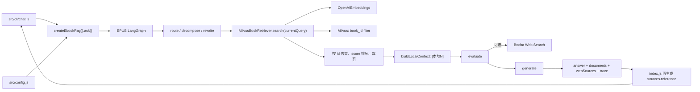
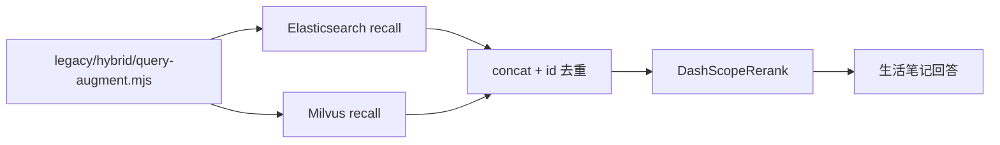
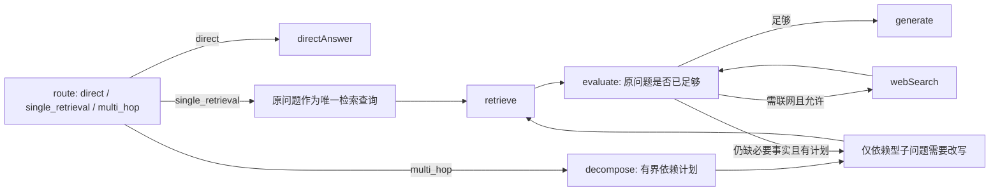

# MemoRAG — SDD 开发规格与分阶段实施计划

> 版本：v0.4（2026-10-12）
>
> 状态：**P3-0、P3-1、P3-2 已完成；Graph recursion limit 修复已通过真实环境复验；P3-2.1 决策与检索效率优化已完成设计、待确认实施。**
>
> 本版依据当前仓库代码、测试、已安装依赖与旧 Demo 核对。除非明确标注为“已验证”，本文不把历史报告、配置名或旧 Demo 当作现有能力。

## 1. 产品目标与优先级

建立一个以 **Agentic RAG 能力**为核心的智能问答系统，支持两类相互隔离的知识库：

1. **EPUB 电子书**：导入 EPUB、解析/分块/Embedding/向量入库、按 `bookId` 检索、回答与原文引用。
2. **生活笔记**：笔记增删改查、原始笔记存储、同步建立 Elasticsearch 关键词索引与 Milvus 向量索引、问答与来源引用。

共用能力包括：问题路由、多跳问题拆分、依赖型子问题改写、检索轮次限制、证据充分性评估、可选联网补充、引用溯源、Rerank、调用链追踪与测试。

**优先级：RAG 正确性与可验证性 > 数据入库可用性 > API/流式输出 > 简单 React 界面。** 不为堆技术而增加无用复杂度；前端只需演示核心能力。

## 2. P3-0 核对范围与证据边界

本轮只执行了以下只读核对和文档更新：

- 阅读 `backend/src`、`backend/test`、`backend/legacy`、`package.json`、锁文件、`.env.example` 和 README。
- 只读取本地 `.env` 的**变量名**以及非密钥布尔开关状态，不读取或回显任何密钥、URL 值。
- 检查已安装的 `@langchain/*` 与 `langsmith` 源码，以确认当前锁定版本实际接受的环境变量别名。
- 查阅阿里云 Model Studio 官方 Rerank HTTP 协议；未发起 Rerank 请求。
- 未连接 Elasticsearch、Milvus、LangSmith 或 Bocha，未执行数据库读写、付费 API 或真实模型调用。

因此，下列结论必须保持边界：

- `ebook_collection`、1024 维和字符串 `bookId` 是**当前代码默认值/契约**；本轮没有连接 Milvus，不能把它们表述为现存数据库 Schema 的再次验证结果。
- `life_notes` 只是旧 Demo 中的硬编码索引/Collection 名称；仓库没有 Schema、mapping、migration 或探测结果，不能证明任何生活笔记索引实际存在。
- 上轮真实 CLI 结果仅作为历史观察保留；本轮没有复跑真实问答。

## 3. 当前仓库架构与依赖图

### 3.1 当前主线



`createEbookRag()` 通过依赖注入允许 Mock `model`、`retriever` 和 `webSearch`；这也是当前测试不访问真实服务的基础。

### 3.2 旧 Demo（未接入当前主线）



旧混合检索文件具有模块加载即创建客户端、连接既有 Collection、执行图和调用模型的顶层副作用。当前 `package.json` 也未声明它所需的 `@elastic/elasticsearch` 和 `@langchain/community`。因此它不是可直接导入的生产模块。

## 4. 现有能力核对结果

| 能力 | 代码证据 | P3-0 结论 |
| --- | --- | --- |
| `createEbookRag().ask(question, options)` | `src/rag/ebook/index.js` | **已实现**；返回 `answer`、`route`、`sources`、`webSources`、`trace`。 |
| simple/complex 路由与 simple 直答 | `agent-graph.js` 的 `routeQuestion` / `directAnswer` | **已实现并有 Mock 测试**；simple 分支不检索。 |
| 问题拆分 | `decomposeQuestion` | **已实现并有 Mock 覆盖**。 |
| 依赖型子问题改写 | `rewriteSubQuestion`、`validateRewrite` | **已实现并有 Mock 覆盖**；会检查支持文档、实体落地、冲突及模型异常回退。历史真实运行尚未证明进入 `rewritten` 分支。 |
| 改写查询进入实际检索 | `retrieveNode` 使用 `state.currentQuery` | **已实现并有 Mock 覆盖**。 |
| EPUB Milvus 只读检索 | `milvus-retriever.js` | **代码已实现**；Embedding 维度校验、`book_id` 过滤、COSINE、`nprobe` 和字段映射有 Mock 测试。本轮未连真实 Milvus。 |
| 多轮检索、去重、裁剪 | `mergeUniqueDocuments` | **已实现并有 Mock 覆盖**；同 ID 保留较高 Milvus `score`，再排序并限制数量。 |
| 检索/联网次数上限 | `evaluateNode` | **已实现并有 Mock 覆盖**。 |
| Bocha 可选联网 | `config.js`、`web-search.js` | **部分实现**；无 Key 或开关关闭时禁用，次数限制有效；但请求失败会直接抛错，当前没有运行时降级。旧规格中的“Bocha 降级已实现”不成立。 |
| 回答、本地来源、网页来源、执行 trace | `generateNode`、`index.js` | **已实现基础结构**；P3-1 已修复本地引用快照与编号合法性，多轮网页编号仍是已知限制，见第 6 节。 |
| Qwen Rerank | 仅 `legacy/hybrid/dashscope-rerank.mjs` | **未接入主线**。 |
| EPUB 的 ES 混合检索 | 无代码、无索引定义 | **不存在**，本阶段也不设计为 EPUB 能力。 |
| 生活笔记 ES + Milvus 检索 | 仅旧 Demo | **未产品化**；无当前适配层、配置、隔离或测试。 |
| 生活笔记 CRUD / 原始存储 / 双写 | 无当前代码 | **未实现**，属于 P4-B。 |
| LangSmith | 由当前 LangChain SDK 根据进程 env 自动启用 | **隐式可用但未受应用控制**；没有显式隐私策略、脱敏、测试隔离或 README 说明。 |
| EPUB 入库 | 仅 `legacy/agentic/ebook-writter.mjs` | **不属于当前主线**；旧脚本会创建索引并写 Milvus，且使用 `ebook2`，本阶段禁止执行。 |

### 4.1 测试基线

当前有 4 个测试文件，共 16 个 `test()` 声明：

- `agent-graph.test.js`：11 项。
- `config.test.js`：2 项。
- `ebook-rag.test.js`：1 项。
- `milvus-retriever.test.js`：2 项。

在当前 `.env` 下直接执行 `npm test`，测试进程在输出前两个文件后 30 秒内未结束；这是因为当前非密钥开关 `LANGSMITH_TRACING` 处于启用状态，而包含图调用的 Mock 测试会尝试处理外部 trace。显式关闭新旧追踪开关后：

```bash
LANGSMITH_TRACING=false \
LANGSMITH_TRACING_V2=false \
LANGCHAIN_TRACING=false \
LANGCHAIN_TRACING_V2=false \
npm test
```

结果为 4/4 文件级 suite 通过、0 失败，耗时约 0.57 秒。Node 22 的父测试进程按文件汇总为 4 项；源码中实际有 16 个 `test()` 声明。P3 后续所有 Mock 测试都必须显式隔离外部 tracing，不能依赖开发机 `.env`。

## 5. 旧版混合检索与 Rerank 可复用性

| 旧实现 | 可复用内容 | 不可直接复用/必须修正 |
| --- | --- | --- |
| `legacy/hybrid/dashscope-rerank.mjs` | Bearer 鉴权、`model/query/documents/top_n` 请求形状、按返回 `index` 映射原文档的核心思路 | 无超时；不校验空 URL/Key、重复或越界 index；不保留 `relevance_score` 和原始 rank；错误包含完整响应；打印服务返回；只接受顶层 `results`；没有失败回退。应迁移为无副作用的当前模块并补测试，不直接复制类。 |
| `legacy/hybrid/query-augment.mjs` | 结构化三路查询、失败回退、查询去重思路 | 会额外调用 LLM；固定三条；与当前“拆题 + 依赖改写”可能重复放大召回和成本。P3-4 最小实现默认不启用查询扩展，先保证 `currentQuery` 原样透传；后续再以独立开关评测。 |
| `legacy/hybrid/hybrid-retrieval.mjs` | ES hit 转文档、按逻辑 ID 去重、ES/Milvus 并行召回、空集合跳过 Rerank 的思路 | 顶层即连接/执行；依赖缺失；ES 地址、`life_notes`、召回数硬编码；没有 `userId`/知识库过滤；只是 ES 在前、Milvus 在后拼接，既没有 RRF 也没有可靠融合；导入会触发真实服务和模型调用。只能重写为适配层。 |
| `legacy/agentic/agentic-rag.mjs` | 历史节点设计可作对照 | 当前 `src/rag/ebook/agent-graph.js` 已有更完整、安全的改写和可测试结构，不回迁旧实现。 |
| `legacy/agentic/ebook-writter.mjs` | 后续 P4-A 可参考 EPUB 分章、分块和批量写入流程 | 会创建/加载/写入 Collection，名称和部分字段值与当前契约不一致；P3 禁止运行或复用。 |

### 5.1 Rerank 协议核对

阿里云 Model Studio 当前 `qwen3-rerank` HTTP 兼容协议使用 Bearer Key，正文为顶层 `model`、`query`、`documents`、`top_n`，成功响应在顶层返回按相关性排序的 `results[]`，每项包含输入 `index` 和 `relevance_score`。旧 Demo 的基本请求/响应形状与该协议兼容，前提是 `RERANK_URL` 已指向对应地域和 Workspace 的完整 `/reranks` 端点。

官方参考：<https://docs.modelstudio.console.alibabacloud.com/en/model-studio/text-rerank-api>

本轮为避免暴露配置，未读取当前 `RERANK_URL` 值，也未发送请求；因此不能声称实际端点或鉴权已经联调。若 URL 指向旧的 `gte-rerank` 服务，旧 Demo 的顶层请求形状未必兼容。

## 6. 引用编号问题定位

### 6.1 P3-0 核对时的本地引用数据流（修复前）

1. `retrieveNode` 将新结果交给 `mergeUniqueDocuments`，按 ID 去重、按 `score` 重排并裁剪至 `maxContextDocuments`。
2. 同一节点立即以该 `documents` 数组调用 `buildLocalContext`，按数组下标生成 `[本地1]`～`[本地N]`。
3. `generateNode` 将 `state.localContext` 原样放入模型提示词。
4. 图结束后，`src/rag/ebook/index.js` 对 `result.documents` 再按数组下标生成 `sources[].reference`。
5. `src/cli/chat.js` 对 `result.sources` 使用 `forEach` 全量输出，只把每条正文预览裁剪到 140 字符；它**没有限制来源条数**。

### 6.2 P3-0 定位结论

- 当前代码中，从最后一次 `localContext` 重建到生成和输出之间没有再次改变 `documents` 的路径。因此在同一次当前版本执行里，`localContext` 与 `sources` 的本地数组顺序理论上相同。
- CLI 不会把第 15 条来源截掉；“只显示 14 条”的原因不是 CLI 条数限制。
- `generateNode` 只用自然语言要求模型不要虚构引用，返回后没有解析或校验 `[本地N]`。所以当最终只有 14 条来源时，模型生成 `[本地15]` 会被原样返回。这是当前代码可以确定的首要缺口。
- 因本轮禁止真实付费调用，历史那一次 `[本地15]` 的原始响应未复跑；P3-1 必须先用 14 条 Mock 文档和包含 `[本地15]` 的脚本化答案确定性复现，再修复。
- 本地映射目前是“两处按下标独立重建”，虽暂时同序，Rerank 接入后风险会升高；必须改为同一份最终引用快照驱动 prompt 和 API 输出。

### 6.3 已确认的网页引用问题

`createBochaWebSearch()` 每次调用都从 `[网页1]` 开始生成 `text`，但 `index.js` 对多轮累计的 `webSources` 再从 1 全局编号。第二轮上下文里的 `[网页1]` 最终可能对应 `webSources` 中的 `[网页N]`。本轮 P3-1 按用户确认范围只修复本地引用；多轮网页编号仍是已知未完成项，后续启用多轮网页引用前必须单独修复并验收。

### 6.4 P3-1 最小定位路径

```text
mergeUniqueDocuments
  → 引用快照/编号
  → buildLocalContext
  → generateNode 模型输出
  → 引用解析与合法性校验
  → createEbookRag().sources / webSources
  → CLI 展示
```

“编号存在且可映射”只证明引用格式有效，不证明被引用片段在语义上支持答案。语义蕴含/忠实度评估留在 P5，P3-1 不得宣称自动解决。

## 7. 环境变量与版本兼容核对

### 7.1 当前安装版本

| 包 | 实际安装版本 |
| --- | --- |
| `@langchain/core` | `1.2.17` |
| `@langchain/langgraph` | `1.4.21` |
| `@langchain/openai` | `1.6.2` |
| `langsmith`（传递依赖） | `0.10.11` |
| `@zilliz/milvus2-sdk-node` | `3.0.6` |

### 7.2 LangSmith

对本地已安装源码的核对结论：

- 追踪开关同时识别 `LANGSMITH_TRACING`、`LANGSMITH_TRACING_V2`、旧名 `LANGCHAIN_TRACING` 和 `LANGCHAIN_TRACING_V2`；值只有精确的字符串 `"true"` 才启用。
- API Key、Project 和 Endpoint 通过同一别名读取器解析，优先 `LANGSMITH_*`，再回退 `LANGCHAIN_*`。因此当前 `.env` 中 `LANGSMITH_TRACING` + `LANGCHAIN_API_KEY` + `LANGCHAIN_PROJECT` 的混合命名，在已安装版本上是兼容的。
- SDK 还接受 `LANGSMITH_HIDE_INPUTS`、`LANGSMITH_HIDE_OUTPUTS`、`LANGSMITH_HIDE_METADATA`（以及相应 `LANGCHAIN_*` 别名）。仅隐藏正文但保留安全元数据时，P3-3 应使用显式 Client/Tracer 配置，不能假定设置 env 就完成脱敏。
- 当前应用代码没有 LangSmith 配置对象或隐私边界；`config.js` 加载 `.env` 后，LangChain 会自动读取这些变量。因此开发机上的全局开关会影响 Mock 测试和所有图调用。
- `.env.example` 当前没有任何 LangSmith 变量。P3-3 才允许更新它，本轮不修改。

冻结的兼容策略：

1. 文档和新增配置优先使用 `LANGSMITH_TRACING`、`LANGSMITH_API_KEY`、`LANGSMITH_PROJECT`。
2. 兼容 `LANGCHAIN_API_KEY`、`LANGCHAIN_PROJECT` 以及旧追踪开关；同类变量同时存在时 `LANGSMITH_*` 优先。
3. 默认不开启外部追踪。`metadata_only` 为默认内容策略：保留节点名、耗时、次数、文档 ID、前后 rank 和错误类别，不上传完整 `content`、`localContext`、`webContext` 或生成答案。
4. 生活笔记即使进程级追踪已打开，也必须默认使用 `tracingEnabled: false` 的作用域；只有独立的显式私有数据授权开关开启后才允许 trace，且仍默认 `metadata_only`。
5. Mock 测试必须使用假 Client/Tracer 或显式禁用追踪；不能连接 LangSmith 云端。

### 7.3 Rerank

当前真实 `.env`（仅核对变量名）已有 `RERANK_MODEL`、`RERANK_URL`，没有独立的 `RERANK_API_KEY`；旧 Demo 复用 `OPENAI_API_KEY`。`.env.example` 尚未列出任何 Rerank 变量。

冻结的兼容策略：

| 变量 | 规则 |
| --- | --- |
| `ENABLE_RERANK` | 新增，默认 `false`；关闭时不得构造 Rerank 请求。 |
| `RERANK_URL` | 保留旧名；启用时必填完整 HTTP 端点，不在代码中猜测地域或 Workspace。 |
| `RERANK_MODEL` | 保留旧名；默认 `qwen3-rerank`。 |
| `RERANK_API_KEY` | 新增首选专用 Key。 |
| `DASHSCOPE_API_KEY` | 新增兼容官方常用命名，优先级低于 `RERANK_API_KEY`。 |
| `OPENAI_API_KEY` | 为兼容旧 Demo 的最后回退；文档需提示最好使用专用 Rerank Key。 |
| `RERANK_TOP_N` | 新增；默认沿用最终 `RETRIEVAL_K`。调用级 `askOptions.k` 优先。 |
| `RERANK_CANDIDATE_K` | 新增；必须不小于最终 `topN`，默认至少 20，用于扩大 Milvus 初召回。 |
| `RERANK_TIMEOUT_MS` | 新增，默认 10000 ms。 |
| `RERANK_FAILURE_MODE` | 新增，`fallback`（默认）或 `error`。 |

任何日志、trace 或异常都不得包含 Authorization、Key 或完整服务响应。

## 8. 全局不可破坏约束（Invariants）

- 保持 `createEbookRag().ask(question, options)` 的调用方式，保持 `answer`、`route`、`sources`、`webSources`、`trace` 等现有字段兼容；只允许向后兼容新增字段。
- 不改变 `question` 原始值；动态改写后的实际查询必须进入 Retriever 和启用时的 Rerank，并保留原始子问题及改写记录。
- simple 分支、最大检索次数、最大联网次数、文档 ID 去重与 `bookId` 过滤持续有效。
- Bocha 的“未配置即禁用”行为持续有效；运行时请求失败降级目前未实现，不能误写为已完成，也不在 P3-1～P3-4 中顺手扩 scope。
- **严格知识库隔离**：EPUB 与生活笔记不可误混检；生活笔记必须在 ES 与 Milvus 查询阶段都强制 `userId` 和知识库范围，并对返回结果二次校验。
- 不能跨 Elasticsearch/Milvus 比较原始分数并直接混排；P3-4 使用 rank-based fusion，Rerank 分数和向量分数分别保留。
- **禁止数据库写操作**：P3 只做只读检索和 Mock 测试；不创建、删除、覆盖或重建 Collection/Index，不插入、更新、删除数据。
- 不读取、回显或提交真实密钥。`.env` 不进 Git；新增配置只把变量名和无密钥占位符写入 `.env.example`。
- 默认使用 Mock 测试，不批量触发付费模型、Rerank、联网或 LangSmith API。真实联调必须逐次取得明确授权，并区分 Mock 与真实结果。
- LangSmith 开启时可能上传问题、prompt、上下文、输出和元数据；默认关闭，生活笔记另设默认关闭的作用域保护，不能仅靠“日志不打印原文”声称无外传。

## 9. P3-1～P3-4 可执行任务清单

任务严格按 `P3-1 → P3-2 → P3-2.1 → P3-3 → P3-4` 执行，一次只做一个任务。每轮完成后先报告并等待用户确认。

### P3-1：引用快照与编号一致性（**代码完成：2026-10-12**）

**完成状态**：本地引用修复代码已完成，20/20 Mock 测试通过；未调用真实模型，真实模型的引用纠正效果待验证。

**实现结果**：

- 生成前在最后一次文档去重、按分数排序和 `maxContextDocuments` 裁剪后冻结有序 `citationDocuments` 快照；`localContext` 与 API `sources` 均由该快照派生，确保 `[本地N]`、文档 ID 和返回数组下标一致。
- 生成后解析所有 `[本地N]`，并以快照长度检查编号是否为规范的 `1..N`。例如只有 14 条来源时，`[本地15]` 会被识别为无效引用；实现不会把越界编号钳制或直接映射成 `[本地14]`。
- 检测到无效引用时，默认最多使用同一份资料快照纠正生成 1 次。纠正提示要求只使用实际存在且资料中提供的引用，并禁止伪造或改变来源 ID；只有纠正输出本身不再含越界编号时才通过编号校验。
- 若纠正调用失败、返回空答案或仍含无效编号，安全回退只移除最终答案中的无效引用标记，保留合法引用和真实来源，不新增来源、不修改来源 ID。
- `trace.citationValidation` 向后兼容地记录状态、来源数量、初始/最终引用、初始无效引用、纠正次数、纠正调用是否失败以及最终移除的无效引用。
- `sources` 可以包含未被答案引用的候选，但答案中的每个有效编号必须能映射到且只能映射到一个来源。
- `answer`、`sources`、`webSources`、`trace` 等原有字段未删除或改名；只在 `trace` 中新增 `citationValidation`。
- `contentSupportChecked` 固定记录为 `false`：当前只验证引用编号存在且可映射，不判断引用片段在语义上是否足以支持对应论述。语义充分性/忠实度仍属于 P5。

**相对 P3-0 冻结设计的变更原因**：

- 冻结稿原计划发现越界引用后直接清理且不重试；本轮实施指令改为优先有限次数纠正，因此实现默认最多纠正 1 次，并在失败后执行确定性清理。
- 冻结稿同时规划了多轮网页全局编号；本轮确认的代码范围只涉及本地 `[本地N]`，因此未修改 `web-search.js`。该问题保留为已知未完成项，不计入本次 20 项 Mock 通过的能力范围。

**修改文件**：

- `backend/src/rag/ebook/agent-graph.js`：引用快照、生成后校验、有限纠正、安全清理与 trace。
- `backend/src/rag/ebook/index.js`：从 `citationDocuments` 快照输出稳定 `sources`，暴露兼容的 `trace.citationValidation`。
- `backend/test/agent-graph.test.js`：覆盖去重、重排、裁剪、合法引用保留、纠正失败清理及普通无引用答案。
- `backend/test/ebook-rag.test.js`：覆盖 14 条来源却生成 `[本地15]`，以及纠正后 `[本地14]` 与 `sources[13]` 的映射。
- `docs/specs/memorag-roadmap.md`：记录 P3-1 状态、实现、测试与限制。

**测试与验收结果**：

- 使用脚本化 Mock 确定性复现“14 条来源但答案含 `[本地15]`”，验证纠正后只保留可映射的 `[本地14]`，同时 trace 保留初始无效编号。
- 覆盖重复 ID 保留高分、重新排序、裁剪后 prompt 编号与引用快照一致；合法 `[本地1]` / `[本地2]` 原样保留。
- 覆盖纠正后仍含非法编号时的清理路径，以及无引用普通答案不触发额外纠正。
- 测试命令显式关闭 `LANGSMITH_TRACING`、`LANGSMITH_TRACING_V2`、`LANGCHAIN_TRACING`、`LANGCHAIN_TRACING_V2`；4 个测试文件共 20 项，20 通过、0 失败。
- 全部测试使用 Mock；未访问真实模型、Milvus、Bocha 或 LangSmith，未执行数据库写入。

**已知限制与尚未完成事项**：

- 真实模型是否能在一次纠正内稳定选择正确且受资料支持的引用尚未验证；不得把 Mock 通过表述为真实纠正效果已验收。
- 当前校验只能证明编号合法并能映射到来源，不能证明引用内容足以支持论述；`contentSupportChecked: false` 明确记录该边界。
- 多轮网页引用的累计编号问题仍未修复；在单独完成该项前，不能宣称网页引用已具备与本地引用相同的一致性保证。
- 最终清理会改变 `answer` 字符串，且删除标记后局部语句可能不够自然；trace 会保留诊断证据，避免静默掩盖模型错误。

**依赖关系**：仅依赖 P3-0 冻结；本地引用快照可作为 P3-2 和 P3-4 的前置基础。本轮结束后不自动开始 P3-2。

### P3-2：EPUB Milvus 候选集接入可选 Qwen Rerank（**代码完成：2026-10-12**）

**目标**：保持 EPUB 只读 Milvus 检索，在功能开关启用时扩大候选集并使用 Qwen Rerank，失败时按配置回退。

**完成状态**：代码及 Graph recursion limit 修复与 39/39 Mock 回归测试已完成；用户已确认修复后的真实环境问答能够结束。真实运行同时暴露过度拆题与检索成本问题，转入 P3-2.1；Qwen Rerank 的系统性排序质量仍待独立评测。

**实现结果**：

- 将旧 Demo 的 Bearer 鉴权及 `model/query/documents/top_n` 请求协议迁移为无顶层副作用的 `DashScopeReranker`，未引入 `@langchain/community`；客户端支持超时，并校验 HTTP 状态、JSON、结果数组、结果数量、相关性分数及缺失/重复/越界 index。
- 新增可选 `RerankingBookRetriever`：启用时使用不小于最终 `topN` 的候选数执行原 Milvus 只读检索，在调用 Rerank 前及映射返回结果后均校验 `bookId`；空的同书候选集不发请求。
- `askOptions.k` 继续表示单轮最终文档数并优先于 `RERANK_TOP_N`；动态改写后的 `currentQuery` 原样传给 Milvus 与 Rerank。关闭 `ENABLE_RERANK` 时不构造请求，保持原检索与 API 行为。
- 保留 Milvus `score` 和全部文档字段，向后兼容新增 `rerankScore`、`originalRank`、`rerankRank`、`rerankStatus`、`rankFusionScore` 元数据；Rerank 分数不会覆盖向量分数。
- 启用 Rerank 后，多轮同 ID 文档按 `1 / (60 + rank)` 累加贡献；并列时按首次出现顺序和文档 ID 稳定排序，不会再次按原始向量分数覆盖重排结果。最终排序仍由 P3-1 的引用快照统一生成 `localContext` 与 `sources`。
- `fallback` 模式在超时、HTTP/网络错误或非法响应时保留原 Milvus 顺序，并仅在 `trace.retrievals[].rerank` 记录安全失败类别、候选/返回数量、文档 ID 和 rank 变化；`error` 模式直接抛出异常。异常和 trace 不包含 Key、Authorization、完整响应或文档正文。
- 配置新增 `ENABLE_RERANK`、`RERANK_URL`、`RERANK_MODEL`、`RERANK_API_KEY`、`DASHSCOPE_API_KEY`、`RERANK_TOP_N`、`RERANK_CANDIDATE_K`、`RERANK_TIMEOUT_MS`、`RERANK_FAILURE_MODE`；Key 优先级为专用 Rerank Key、DashScope Key、旧 Demo 兼容的 OpenAI Key。
- `createEbookRag().ask()` 根据本次调用的本地检索上限和是否可联网，使用图结构的严格上界 `3 * maxRetrievals + 2 * maxWebSearches + 4` 设置 LangGraph `recursionLimit`，覆盖最终 `END` superstep，而不是使用任意放大的固定值。

**冻结设计**：

- 将旧 `DashScopeRerank` 的协议逻辑迁移到无顶层副作用的当前模块；不依赖旧 Hybrid 文件，也不要求引入 `@langchain/community`。
- `askOptions.k` 仍表示最终每轮文档数并优先于 `RERANK_TOP_N`；Milvus 初召回使用不小于最终数量的 `RERANK_CANDIDATE_K`。
- Rerank 输入严格限于同一 `bookId` 的 Milvus 返回结果；调用前与返回后都校验 `bookId`，不得跨书补候选。
- Rerank 查询必须是 `retrieveNode` 实际使用的 `currentQuery`，包括合法的动态改写结果。
- 保留原始 Milvus `score`，新增 `rerankScore`、原始/重排 rank 和状态元数据；不得用 Rerank 分数覆盖向量分数。
- 多轮文档合并不得在 Rerank 后又按原始向量分数把顺序改回去。启用 Rerank 时使用 rank-based 分数 `1 / (60 + rank)` 聚合（`rank` 从 1 开始），同 ID 累加贡献；并列时依次按首次出现顺序、文档 ID 稳定排序。
- 空候选不请求服务；超时、非 2xx、非法 JSON、缺失/重复/越界 index 均按 `RERANK_FAILURE_MODE` 处理。默认 `fallback` 返回原 Milvus 顺序并记录非敏感失败类别。
- `ENABLE_RERANK=false` 时不构造请求，并维持现有无 Rerank 行为。

**修改文件**：

- `backend/src/rag/shared/dashscope-reranker.js`：HTTP 协议、超时、响应校验与安全错误分类。
- `backend/src/rag/ebook/reranking-retriever.js`：候选扩展、同书隔离、结果映射、失败策略与安全 trace。
- `backend/src/config.js`、`backend/.env.example`：Rerank 配置、默认值、兼容优先级与校验。
- `backend/src/rag/ebook/index.js`、`backend/src/rag/ebook/agent-graph.js`：可选装配、实际查询透传、RRF 合并与对外 trace。
- `backend/test/dashscope-reranker.test.js`、`backend/test/reranking-retriever.test.js`：客户端及检索包装层单元测试。
- `backend/test/config.test.js`、`backend/test/agent-graph.test.js`、`backend/test/ebook-rag.test.js`：配置、融合、动态改写、关闭开关、API 与 P3-1 回归测试。
- `backend/README.md`：配置、数据流、失败模式及真实端点未验收说明。
- `docs/specs/memorag-roadmap.md`：P3-2 状态、实现、测试和限制。

**依赖关系**：依赖 P3-1 的稳定引用快照；其共享 Reranker 是 P3-4 的前置。

**验收条件**：

1. Mock HTTP 断言 Bearer 鉴权和 `model/query/documents/top_n` 请求体正确，但测试输出不含 Key。
2. 覆盖排序、`relevance_score` 保存、文档 ID/章节/正文/`bookId` 字段保留、同书过滤和改写查询透传。
3. 覆盖空集合不调用、超时、HTTP 错误、非法响应、重复/越界 index；默认回退顺序正确且 trace 有失败类别。
4. 覆盖多轮 Rerank 后使用冻结的 rank fusion，最终来源顺序与 P3-1 引用快照一致；原始 `score` 未被覆盖。
5. 关闭开关时零 Rerank 调用、现有结果语义和 API 结构不变。
6. 全部测试使用 Mock。只有用户另行提供有效凭证并明确授权后，才允许一次单查询、只读、小候选集的真实联调；未授权时必须标记“协议已 Mock，真实端点未验收”。

**真实环境故障与修复记录（2026-10-12）**：

- 用户真实环境分别以 `ENABLE_RERANK=true` 和 `ENABLE_RERANK=false` 执行同一问题，两者均触发默认 `Recursion limit of 25 reached`，因此故障不能归因于 Rerank。
- 检查确认 `retrieveNode` 每轮都会同时递增 `retrievalCount` 和 `nextSubIdx`，`webSearchNode` 会递增 `webSearchCount`；`evaluateNode` 在对应上限耗尽后强制进入 `generate`。条件边没有无界回路。
- 根因是合法复杂路径超过 LangGraph 默认 25 步：8 次本地检索需要执行 27 个节点，并需要第 28 个终止 superstep；若再执行 2 次联网，需执行 31 个节点并需要第 32 个终止 superstep。
- Mock 在默认 25 步下精确复现了节点序列于第 8 次 `retrieve` 后报错；按公式设置 28/32 后，纯本地最大路径及“8 次本地检索 + 2 次联网”最大路径均正常进入 `generate` 并结束。
- 与 P3-1 提交对比，循环边、索引和计数推进逻辑并非 P3-2 引入；Rerank 只可能通过证据排序影响评估器是否提早结束，不改变循环的理论上限。

**测试与验收结果**：

- 6 个测试文件共 39 项，39 通过、0 失败；运行时显式设置 `LANGSMITH_TRACING=false`、`LANGSMITH_TRACING_V2=false`、`LANGCHAIN_TRACING=false`、`LANGCHAIN_TRACING_V2=false`。
- Mock HTTP 已验证 Bearer 请求头和旧 Demo 的请求体形状；覆盖空候选、超时、非 2xx、非法 JSON、缺失/重复/越界 index，以及错误信息不泄露测试 Key 或响应正文。
- 检索测试覆盖候选扩大、`askOptions.k` 优先、同书过滤、字段与原始 `score` 保留、默认回退及 `error` 模式；Graph/API 回归覆盖动态改写查询透传、RRF、多轮 trace、开关关闭时零 Rerank 调用和原有 `answer/sources/webSources/trace` 接口。
- Graph 终止回归记录并断言最大合法节点序列、每轮子问题索引/检索次数、每轮联网次数；同时覆盖 Rerank 关闭、正常返回和异常回退时，证据持续不足且评估器重复要求检索仍能在第 8 次后生成并终止。
- P3-1 的引用编号纠正、simple/complex 路由、检索轮次、可选联网与纯 Milvus 检索测试全部继续通过。全程未访问真实模型、Qwen Rerank、Milvus、Bocha 或 LangSmith，也未执行数据库写入。

**已知限制与尚未完成事项**：

- 真实 Qwen Rerank 端点的协议兼容性、模型可用性、延迟、费用、限流和排序质量尚未验收；当前只能表述为 Mock 协议与本地排序逻辑通过。
- 用户已确认修复后的真实环境问答能够结束；本次复验同时观察到单一问题被拆成 8 个子问题、执行 8 次本地检索并累计 23 条来源，属于 P3-2.1 的已确认效率与决策质量问题。
- 默认关闭 Rerank；启用会把候选正文发送到配置的外部端点。部署方需自行确认数据授权、地域与服务条款，并优先使用专用 `RERANK_API_KEY`。
- `fallback` 保障服务故障时可继续回答，但不能提供 Rerank 质量提升；跨查询只融合 rank，不比较不同查询间不可直接比较的原始 Rerank 分数。
- P3-3 的显式 LangSmith 隔离和 P3-4 的 ES + Milvus 混合检索均未开始，其任务状态保持不变。

**主要风险**：不同查询的原始 Rerank 分数不可直接比较，因此跨子问题只融合 rank，不融合原始分数；候选集过大会增加费用和延迟，默认关闭。

### P3-2.1：Agent 决策与检索效率优化（**设计冻结，待确认实施**）

**任务性质**：P3-2 的独立小任务；只优化 EPUB Agent 的决策、检索次数、上下文和本地指标，不开始 P3-3/P3-4，不改变数据库，不新增外部服务。本次只完成分析与设计，因此 SDD 仍为 v0.4，代码与测试基线仍是 P3-2 的 39/39。

**真实问题基线**：对“阿朱为什么要假扮段正淳？”的真实问答能够正常结束，但被路由为 `complex`，生成 8 个子问题、执行 8 次本地检索并累计 23 条引用文档；部分子问题与原问题无关或包含未经证实的事实前提，造成延迟和 Token 消耗显著放大。

**代码根因分析**：

1. 当前 `RouteSchema` 只有 `simple|complex`：`simple` 同时表示“不查库”，`complex` 同时表示“要查库且必须拆题”。它没有区分“需要书中证据的单跳问题”和“必须依赖多个事实的多跳问题”。
2. `complex` 唯一路径固定进入 `decomposeQuestionNode`。拆题提示虽然要求最少拆分，却以“输出 1～8 条”提供了较高上限；同时要求每条写全人物/事件名，即使相关实体尚未由证据确认，也会诱导模型提前补全实体或事件。
3. 拆题结果目前只做 trim 和非空检查，没有去重、依赖顺序、必要性或新增前提校验；模型返回 8 条时会全部成为可执行计划。
4. `evaluateNode` 已具备提前选择 `generate` 的能力，所以不是代码强制“必须完成全部子问题”；但 prompt 展示全部未检索项并强调剩余数量，容易让模型把完成计划当作目标，而不是只判断原始问题是否已经可回答。
5. `rewriteSubQuestionNode` 已校验解析实体必须出现在前序证据中，这能阻止无依据实体替换；但它会对第一轮之后的每个子问题调用模型，且只校验实体落地，不校验“为什么/是否/谁”等疑问意图是否被保留，无法阻止把疑问改写成事实断言。
6. 每轮评估都携带完整累计 `localContext`；默认 `MAX_CONTEXT_DOCUMENTS=24`。8 轮路径在不发生引用纠正和联网时，最坏需要 1 次路由、1 次拆题、最多 7 次改写、8 次评估和 1 次生成，即最多 18 次 LLM 调用，另有 8 次 Embedding、启用时 8 次 Rerank。
7. P3-2 Rerank 不生成子问题，也不改变循环上限；它只会通过文档排序间接影响评估器是否认为证据充分。开关关闭时同样存在过度拆题，因此不能通过调整 Rerank 掩盖决策问题。

**最小数据流调整**：



**冻结设计**：

1. **三态路由且保持接口兼容**
   - 将内部路由改为 `direct|single_retrieval|multi_hop`，仍只使用当前一次路由 LLM 调用，不增加分类调用。
   - `direct` 仅用于寒暄、普通常识及不需要书中证据的问题；书中人物、情节、动机、地点或原文问题不得进入直接回答。
   - `single_retrieval` 用于一个完整检索查询即可回答的问题，包括单一人物事实、单一事件和单一动机/因果问题。“阿朱为什么要假扮段正淳？”应进入该路径。
   - `multi_hop` 仅用于答案确实依赖两个及以上事实、关系链、跨人物比较或明确先后推理的问题。
   - 对外 `route.strategy` 继续兼容：`direct` 映射为 `simple`，两个检索模式映射为 `complex`；向后兼容新增 `route.mode` 和 trace 中的路由依据。

2. **单跳 RAG 不拆题**
   - 路由为 `single_retrieval` 时，直接把原始问题设置为唯一 `subQuestion/currentQuery`，跳过 `decomposeQuestionNode` 和 `rewriteSubQuestionNode`，只执行一次本地检索。
   - 检索后仍经过一次 `evaluateNode`，以便资料不足时明确回答不足或在已授权情况下选择联网；由于没有剩余本地子问题，评估器不能发起第二次本地检索。
   - 无联网、无引用纠正时，目标成本为 3 次 LLM 调用（route、evaluate、generate）、1 次 Embedding，以及启用时最多 1 次 Rerank。

3. **多跳拆题改为有界依赖计划**
   - 新增 `MAX_SUB_QUESTIONS`，默认 4、允许 1～8；8 仅作为显式配置的复杂场景上限，不再作为普通问题的默认生成倾向。
   - 拆题结果改为结构化计划项：`question`、`purpose`、`dependsOn`、`introducedAssumptions`。`purpose` 必须说明该项填补原问题的哪一项必要信息；`dependsOn` 只能引用更早的计划项。
   - prompt 明确“通常 2 条，只有不可合并的必要事实才增加”；禁止人物背景、章节盘点、旁支验证和用户未问内容。未知实体必须保留为“前一步确认的人物/事件”等依赖表达，不得猜测并写成具体名称。
   - 代码执行规范化去重、数量限制、依赖下标/环检查；任何未来依赖、重复项、超过上限或显式报告了 `introducedAssumptions` 的计划均 fail closed，回退为只检索原始问题一次，不执行部分可疑计划，也不额外调用验证模型。
   - 该结构校验不能数学证明语义相关性；真实相关性仍需固定问题集评测，文档不得把 Mock 结构校验表述为“消除所有模型幻觉”。

4. **充分即停，不把计划当清单**
   - `EvaluateSchema` 新增 `isSufficient`；只要已有资料能够回答原始问题，代码强制 `nextAction=generate`，即使仍有未执行计划。
   - 只有 `isSufficient=false`、`missing` 非空、下一计划项直接覆盖必要缺口且仍有预算时才允许继续本地检索。
   - prompt 将“原始问题可回答性”放在首位，明确未完成子问题本身不构成证据不足；计划项只是候选检索手段，不是必须完成的 checklist。
   - 保留现有本地检索、联网和 recursion limit 硬上限；模型重复要求检索时仍由代码强制终止。

5. **依赖改写保持疑问意图**
   - 仅 `dependsOn` 非空的计划项调用改写模型；独立子问题直接使用原查询，避免无收益的改写调用。
   - 改写证据只取声明依赖项的检索结果，不再把全部历史证据都暴露给改写器。
   - 继续使用现有“实体必须同时出现在支持文档和改写查询中”的校验，并增加疑问意图守卫：原问题含“谁/为什么/为何/如何/是否/哪里/多少”等标记时，改写结果必须保留对应疑问类型；否则回退原查询并记录原因。
   - 改写只能补全已证实实体，不得新增事件、因果或结论；`reason` 仍不作为事实证据。

6. **上下文和 Token 预算**
   - 保留 P3-1 引用快照和 P3-2 RRF/Rerank 逻辑；将 `MAX_CONTEXT_DOCUMENTS` 默认值从 24 调整为 12，仍允许部署方显式配置。
   - 评估器不再接收完整最终上下文，而只接收当前排序前 6 条、每条最多 600 字符的紧凑证据视图；生成节点仍使用最终引用快照，避免影响引用编号一致性。
   - 改写器只接收声明依赖的最多 4 条证据、每条最多 500 字符。单跳路径天然最多累积一轮结果。
   - 本任务不下调 Milvus/Rerank 单轮 `k`，避免在没有质量评测时同时改变召回宽度；先通过路径和累计上下文上限控制成本。

7. **本地量化指标，不提前实现 P3-3**
   - 在现有 `trace` 中向后兼容新增 `execution`：`totalDurationMs`、逐节点 `durationMs`/执行次数、实际 `llmCallCount`、按 route/decompose/rewrite/evaluate/generate/citation-correction 分类的调用次数、本地检索次数、Rerank 请求/回退次数、联网次数、最终上下文文档数。
   - 指标随单次请求状态累计，不能使用 graph 闭包中的共享可变计数器，以免并发请求互相污染。
   - trace 只记录计数、耗时、节点名、状态和文档 ID，不记录 prompt、完整正文、Key 或完整模型响应；不创建 LangSmith Client，不发送网络请求。P3-3 后续只能复用这些安全 metadata，不能反向扩大本任务范围。

8. **保留真正的多跳能力**
   - `multi_hop` 仍保留有序拆题、证据依赖改写、多轮检索、RRF、Rerank、提前充分性评估和联网分支。
   - 默认 4 条是成本预算而非能力硬删除；确有复杂语料时可显式把 `MAX_SUB_QUESTIONS` 配置到 8，现有 `MAX_RETRIEVALS` 继续作为独立硬上限。
   - 依赖型测试必须证明第二步查询只使用第一步已检索证据解析实体；优化单跳路径不得用“所有问题只检索一次”的方式实现。

**预计修改文件**：

- `backend/src/rag/ebook/agent-graph.js`：三态路由、单跳边、有界计划、依赖驱动改写、充分即停、紧凑评估上下文和请求内指标。
- `backend/src/rag/ebook/index.js`：装配新上限，保持旧 route 字段并新增 `route.mode`、`trace.execution`。
- `backend/src/config.js`、`backend/.env.example`：新增 `MAX_SUB_QUESTIONS=4`，把 `MAX_CONTEXT_DOCUMENTS` 默认/示例调整为 12，并校验最大拆题数不超过 8。
- `backend/test/agent-graph.test.js`：节点路径、计划校验、提前终止、改写意图、上下文边界和指标单元测试。
- `backend/test/ebook-rag.test.js`：单跳/多跳 API 兼容、Rerank 开关与回退、调用次数和来源上限回归。
- `backend/README.md`：路由模式、成本预算、配置和安全 trace 说明。
- `docs/specs/memorag-roadmap.md`：实施后记录完成状态、实际测试数和已知限制。

**Mock 测试设计**：

1. 寒暄进入 `direct`，零检索；书中单一事实/动机进入 `single_retrieval`，不调用拆题和改写。
2. 以“阿朱为什么要假扮段正淳？”为固定回归输入，脚本化路由为单跳后只检索 1 次；原问题原样进入 Milvus/Rerank，来源不超过单轮 `k` 和总上下文上限。
3. 真正依赖型问题仍进入 `multi_hop`，两步计划中的第二步只使用第一步证据完成实体改写，最终回答保留两轮来源。
4. 拆题返回 8 条、重复项、未来依赖或非空 `introducedAssumptions` 时，计划整体拒绝并回退到原问题单次检索；合法配置到 8 时仍受检索硬上限约束。
5. 第一轮资料已经充分但仍有计划项时，评估器返回 `isSufficient=true` 后立即生成；Mock 断言未调用后续 Retriever/Reranker。
6. 评估器持续报告不足时，现有检索/联网上限及 recursion limit 仍保证终止；覆盖 Rerank 关闭、成功和异常回退。
7. 独立的后续子问题不调用改写模型；依赖改写覆盖合法实体、无证据实体、冲突实体及丢失“为什么/谁/是否”等疑问意图的回退。
8. 注入超过 12 条文档和超长正文，断言最终引用快照不超过 12，评估 prompt 只含前 6 条及截断内容，引用编号继续合法。
9. 对 direct、single、multi、引用纠正和 Rerank fallback 路径断言 `trace.execution` 的 LLM/检索/Rerank 次数准确、耗时非负，且不包含正文和测试 Key。
10. 完整运行现有 Mock 回归，显式关闭四个 LangSmith/LangChain tracing 开关；不得访问真实模型、Rerank、Bocha、Milvus 或数据库。

**验收标准**：

1. 固定单跳回归问题只执行 1 次本地检索、0 次拆题、0 次改写；无联网和引用纠正时实际 LLM 调用数为 3，最终来源不超过该次最终 `k`（默认 8）且不超过总上下文上限。
2. 默认多跳计划不超过 4 条；非法计划不会部分执行，trace 明确记录 `fallback_single` 及安全失败原因。
3. 第一轮证据充分时，即使计划仍有剩余项也必须进入生成；不得为了清空计划继续检索。
4. 默认最终本地上下文不超过 12 条；评估上下文不超过 6 条、每条不超过 600 字符；P3-1 引用编号与 P3-2 排序契约全部保持。
5. 真正依赖型两跳/三跳问题继续完成证据约束改写和多轮检索；不得把优化实现为全局单次检索。
6. `answer/route/sources/webSources/trace` 原字段不删除、不改名；`route.strategy` 仍只返回兼容的 `simple|complex`，新增字段均为向后兼容。
7. trace 能给出逐节点耗时、实际 LLM 调用数、本地检索数、Rerank 请求/回退数、联网数和最终上下文数，且不泄露正文、prompt 或凭证。
8. 所有 Mock 回归通过；真实质量验收至少比较固定问题集的 route mode、子问题数、检索数、来源数、总耗时和回答正确性，未获授权前不得主动执行。

**已知限制与决策边界**：

- Mock 只能验证路径和预算，不能证明真实模型一定正确区分单跳/多跳，也不能完全检测模型未主动报告的语义无关项或隐藏错误前提；需要后续小规模固定真实问题集复验。
- 本任务记录本地指标但不做 LangSmith tracing、token usage provider 账单对账或跨请求聚合；这些仍属于 P3-3/质量评测范围。
- 将默认最终上下文降至 12 可能牺牲部分长链问题召回；必须通过真正多跳用例回归，并允许显式配置回 24，但不得因此取消单跳路径和提前终止。

**依赖关系**：依赖 P3-1 引用快照、P3-2 Rerank/trace 和 recursion limit 修复；完成并经用户确认后才允许开始 P3-3。本设计完成后停止，不自动实施。

### P3-3：LangSmith 显式追踪与隐私边界

**目标**：在默认不外传的前提下，可选观察 `route/decompose/rewrite/retrieve/rerank/evaluate/web/generate`，并消除开发机 env 对 Mock 测试的隐式影响。

**冻结设计**：

- 应用显式解析追踪配置和别名，采用第 7.2 节的优先级；未启用时不创建 Client/Tracer，不产生外部请求。
- 若代码直接 import `langsmith`，将它从传递依赖提升为 `package.json` 的直接依赖并锁定兼容版本。
- 内容策略新增应用级 `MEMORAG_LANGSMITH_CONTENT_MODE=metadata_only|full`，默认 `metadata_only`。
- `metadata_only` 使用显式 Client 的 inputs/outputs 隐藏能力，并只通过安全 metadata 记录：节点名、耗时、检索/联网次数、实际查询、文档 ID、Rerank 前后 rank、回退/错误类别。不得上传完整文档正文、拼接上下文、网页摘要、模型完整回答或凭证。
- `full` 只在用户明确知情时用于非私人场景；README 必须说明会上传 prompt、问题、上下文和输出。
- 为未来生活笔记预留独立 `ENABLE_NOTE_LANGSMITH_TRACING=false`。即使全局 `LANGSMITH_TRACING=true`，笔记作用域也用当前 SDK 支持的 `tracingEnabled: false` 阻断继承；只有显式开启才可发送，且默认仍为 `metadata_only`。
- 追踪失败不得影响问答结果；但错误只能记录类型和 request/run id，不记录敏感 payload。

**预计修改范围**：

- `backend/src/config.js`、`.env.example`：追踪、内容模式和笔记独立开关。
- 新增 `backend/src/observability/langsmith.js`：别名归一化、Client/Tracer 构建、关闭作用域和 metadata 白名单/脱敏。
- `backend/src/rag/ebook/index.js`、`agent-graph.js` 及 P3-2 Rerank 包装层：节点名和安全 metadata。
- `backend/package.json`、`package-lock.json`：如直接 import，则声明 `langsmith` 直接依赖。
- 新增 observability/config 测试，更新 graph 回归和 `backend/README.md`。

**依赖关系**：功能上依赖 P3-2，才能一次覆盖 Rerank span；P3-4 必须复用其生活笔记关闭作用域和脱敏策略。

**验收条件**：

1. 不设置开关或设置为 false 时，Mock Client 零调用；现有问答输出完全一致，完整 `npm test` 不等待外部网络。
2. 单元测试证明 `LANGSMITH_*` 优先、`LANGCHAIN_API_KEY` / `LANGCHAIN_PROJECT` / 旧 tracing 名可回退，且测试后恢复 `process.env`，不污染其他 case。
3. 使用内存假 Client 验证全部目标节点可见；metadata 包含 query、文档 ID、rank、次数和错误类别。
4. 在 `metadata_only` payload 中断言不存在测试用敏感哨兵字符串、`content`、`localContext`、`webContext`、完整回答和任何 Key。
5. 全局 tracing=true、笔记开关=false 时，模拟笔记作用域不产生 trace；显式开启后才产生脱敏 trace。
6. 追踪 Client 抛错时问答仍成功，并有不含 payload 的本地诊断。
7. 默认验收不访问 LangSmith 云端。只有明确授权后才做一次最小真实 trace，并把“本地配置通过”和“云端 trace 可见”分别报告。

**主要风险**：LangGraph/LLM 自动 tracing 默认会捕获完整节点输入输出；仅添加 metadata 而不隐藏默认 inputs/outputs 仍会泄露正文，验收必须检查最终 payload。

### P3-4：双知识库检索适配层与生活笔记混合检索

**目标**：EPUB 与生活笔记共享检索契约但采用不同策略；生活笔记实现只读 ES + Milvus 召回、融合和可选 Rerank，不做 CRUD 或索引写入。

**冻结设计**：

- 通用接口：`search(query, { k, scope })`。`scope.knowledgeBase` 必填；EPUB 要求 `bookId`，生活笔记要求 `userId`。现有 `MilvusBookRetriever.search(query, { k, bookId })` 通过兼容适配器继续可用。
- 标准文档至少包含：逻辑 `id`、`knowledgeBase`、可见正文、业务范围字段、原始 metadata、分离的 `scores`、各后端 `provenance`。EPUB 对外仍映射现有 `bookId/bookName/chapterNum/chunkIndex/score/content` 字段。
- EPUB 继续使用 Milvus + 可选 P3-2 Rerank，不创建或声称存在 EPUB ES 索引。
- 生活笔记并行调用 ES 关键词召回与 Milvus 向量召回；两个后端都必须在查询中强制 `knowledgeBase=life_notes` 和 `userId`，合并前再次丢弃范围不符结果。
- ES 与 Milvus 必须携带相同的稳定逻辑笔记 ID。缺失逻辑 ID 的结果不得参与跨源合并，并记录诊断。
- 同 ID 合并 provenance，不同 ID 保留；融合使用 RRF：每个来源贡献 `1 / (60 + rank)`（`rank` 从 1 开始），相加得到 `fusionScore`。不得比较 ES `_score` 与 Milvus cosine 原始值。
- 若启用 Rerank，对融合后的候选调用 P3-2 共享模块，最终截取 `k`；否则按 `fusionScore` 稳定排序。原始 `_score`、cosine、fusion 和 rerank 分数分别保留。
- 旧 query augmentation 不进入最小路径；当前 Agent 的实际 `currentQuery` 必须原样传到两个召回端和 Rerank。查询扩展待独立质量评测后再加默认关闭的开关。
- 本任务不创建索引、不检查生产数据、不实现笔记 CRUD。无双索引测试数据时只完成 Mock 契约，状态标记“真实整合未验收”。

**预计修改范围**：

- 新增 `backend/src/rag/retrieval/`：标准文档、scope 校验、RRF、通用适配器契约。
- 新增 `backend/src/rag/ebook/ebook-retriever.js`：包装当前 Milvus 与 P3-2 Rerank，同时保持旧调用兼容。
- 新增 `backend/src/rag/notes/elasticsearch-retriever.js`、`milvus-retriever.js`、`hybrid-retriever.js` 和入口文件；均只读。
- `backend/src/config.js`、`.env.example`：ES node/index、notes Milvus collection、召回数量等无密钥占位配置。
- `backend/package.json`、锁文件：加入受控版本的 `@elastic/elasticsearch`；不为复用旧 Demo 而引入整个 `@langchain/community`。
- `backend/src/rag/ebook/agent-graph.js` 或通用编排入口：只做适配器调用边界调整，不在本任务实现笔记 CRUD/API/UI。
- 新增 retrieval adapter、scope、RRF、错误降级测试并更新 README。

**依赖关系**：依赖 P3-1 引用契约、P3-2 共享 Reranker、P3-3 tracing 隔离/脱敏；完成后才具备 P4-B 入库设计的可靠读取边界。

**验收条件**：

1. Mock 覆盖同逻辑 ID 跨 ES/Milvus 合并、不同 ID 保留、provenance 和四类分数不丢失；RRF 数值和稳定 tie-break 可断言。
2. 两个后端请求都包含 `userId` 和知识库过滤；注入越权返回时适配层会丢弃，覆盖跨用户、跨知识库和 EPUB/笔记误混场景。
3. 覆盖 ES 空、Milvus 空、双空、单源异常、双源异常和 Rerank 异常；降级策略与错误诊断明确，不泄露连接信息或正文。
4. 覆盖动态改写后的实际查询对 ES、Milvus 和 Rerank 三处完全一致。
5. EPUB 的 `createEbookRag().ask()`、现有字段、`bookId` 过滤、P3-1 引用和 P3-2 排序回归全部通过。
6. 生活笔记 Mock 调用默认不产生 LangSmith trace；显式启用时只出现 P3-3 允许的脱敏 metadata。
7. 不执行任何真实 ES/Milvus 写操作。没有用户提供的只读测试环境与授权时，交付状态必须写明“Mock 已验收，真实索引存在性、mapping 和结果质量未验收”。

**主要风险**：逻辑 ID 或租户字段在两个索引中不一致会造成误合并或越权；适配层必须 fail closed，不能用正文 hash 或后端局部 ID 猜测租户身份。

## 10. 后续阶段（本阶段不实施）

- **P4-A EPUB 入库**：上传/读取 EPUB，解析、分章分块、Embedding、批处理写入；重复导入策略、失败重试、元数据校验；按明确授权进行实际数据库写入测试。
- **P4-B 生活笔记入库**：确定 PostgreSQL 或其他原始数据真源，笔记 CRUD、ES/Milvus 双索引同步、更新/删除一致性、统一 ID、租户隔离和错误补偿。
- **P5 质量评测**：独立评测集、引用真实性、召回质量、Rerank 前后对比、代词改写和联网回退；“引用支持结论”在此验收。
- **P6 接口与体验**：Node HTTP API、SSE 流式输出、CLI、简单 React 页面、来源跳转、执行轨迹与部署。

## 11. 每次 Codex 修改协议

1. 先阅读本规格和当前任务相关文件，报告规格与代码现状的冲突。
2. **只做当前一个 Px-y 任务**，不提前实现下一任务，不做无关重构。
3. 改动前说明拟修改文件、边界与验收测试；需要数据写入或任何真实外部服务调用时先征得用户明确同意。
4. 实施最小可维护改动；不破坏对外接口、功能开关、隔离与安全回退。
5. 新增 Mock 测试并执行完整 `npm test`；测试环境显式关闭外部 tracing，报告测试文件数、测试声明数、真实通过数和未验证项。
6. 最后给出：改动摘要、文件列表、关键数据流、测试证据、遗留风险和下一步建议。
7. 若规格与实际代码不一致，先更新本文并注明原因；重大行为或范围变化须先请求批准。

## 12. P3-0 冻结结论与待用户确认

P3-0 已完成以下设计决策：

- `[本地15]` 的首要缺口是生成后没有引用合法性校验，而不是 CLI 截断；P3-1 已用 Mock 复现并完成本地引用修复。
- P3-1 已建立本地引用快照；原计划中的多轮 `[网页N]` 编号重置问题尚未完成，继续作为已知限制保留。
- 旧 Qwen Rerank 的 HTTP 形状可迁移，但实现本身不能直接复用；P3-2 默认关闭、专用 Key 优先、失败默认回退，并以 rank fusion 防止重排结果被向量分数覆盖。
- 当前 LangSmith 新旧 env 命名兼容，但隐式启用会影响测试并可能上传内容；P3-3 改为显式配置、默认关闭、默认 `metadata_only`，生活笔记另行默认阻断。
- 仓库没有可证明存在的生活笔记 ES/Milvus Schema 或当前实现；P3-4 只交付只读适配层和 Mock 验收，使用 RRF，严格双端租户过滤。

P3-1、P3-2 完成状态与限制见第 9 节；P3-2.1 已完成设计冻结，须由用户确认后才实施。本轮不开始 P3-3 或 P3-4。
